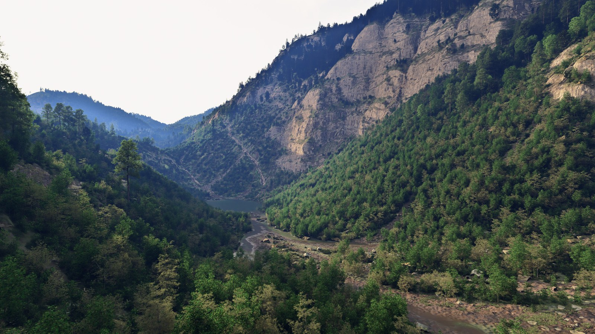
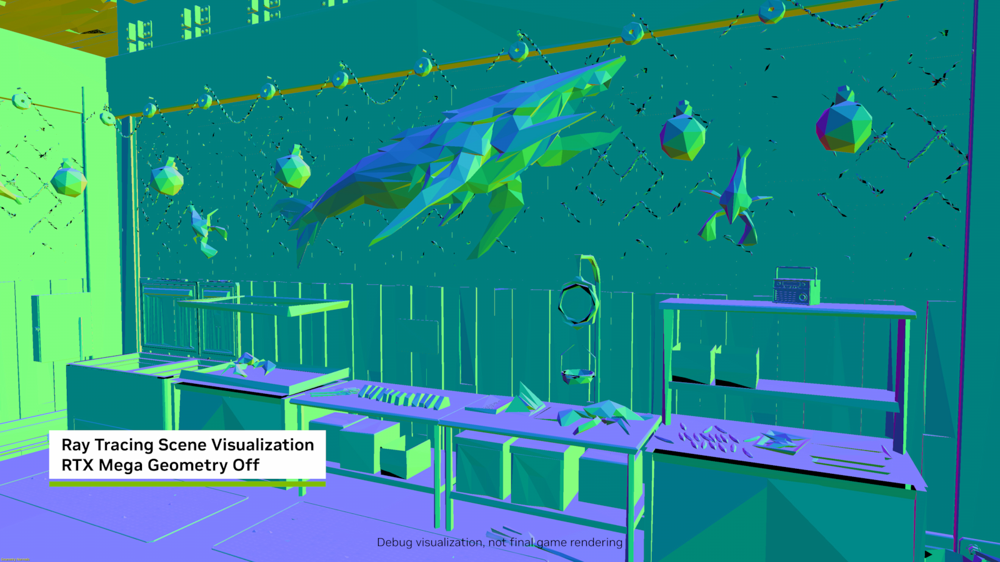
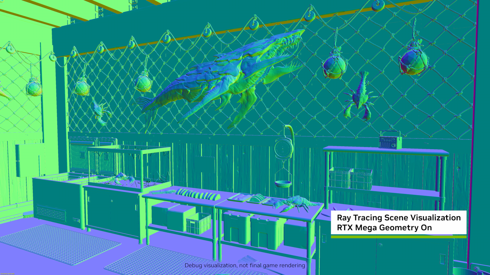
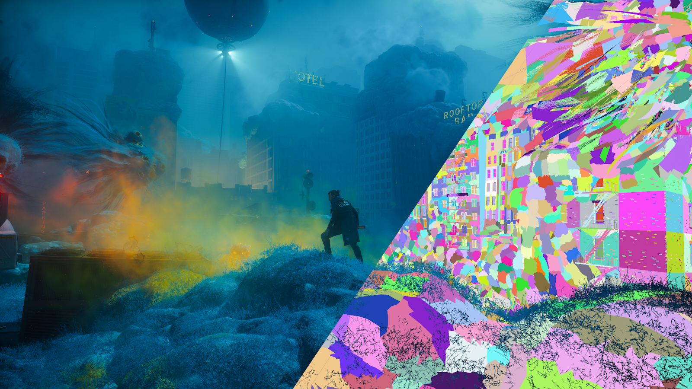
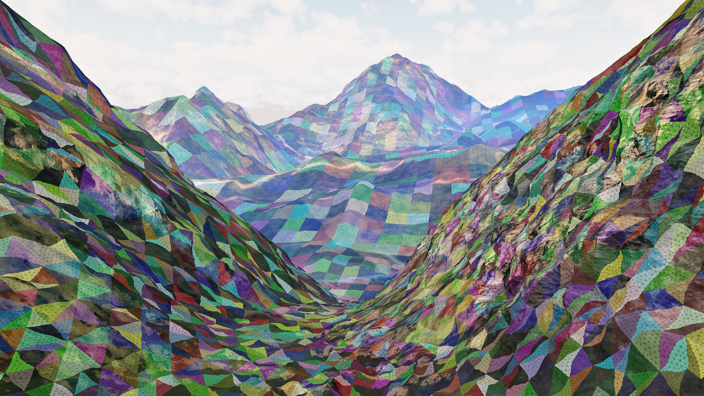
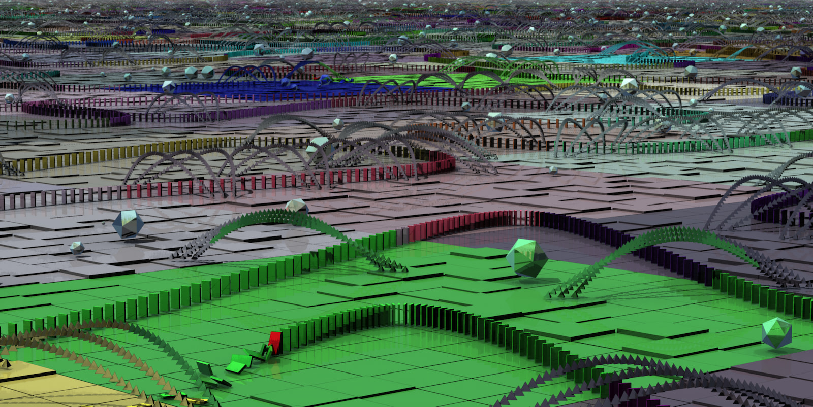
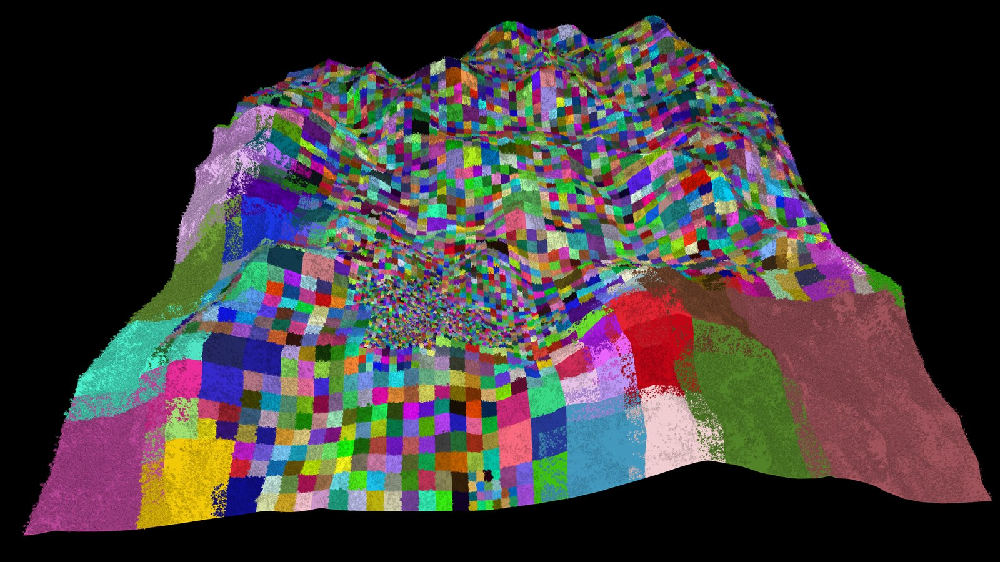

# Clustered Geometry and Partitioned TLAS Launch in DirectX 12, Standardizing RTX Mega Geometry

    

<small>Oct 28, 2026 By Jan Schmid, Nia Bickford, Pascal Gautron, and Christoph Kubisch</small>

Micropolygon-based renderers like Unreal Engine’s Nanite have brought
computer graphics ever closer to the immense geometric detail of reality.
Now, highly detailed and dynamic worlds can be even more efficiently
ray traced than ever before, using DirectX's new Clustered Geometry and Partitioned 
Top-Level Acceleration Structure (PTLAS) features, available in today’s
[DirectX Agility SDK preview](https://devblogs.microsoft.com/directx/clas-ptlas-preview/)
with HLSL 6.10 and supported on the latest NVIDIA Game Ready drivers.

These new features make it dramatically faster to build the
acceleration structures used for ray tracing.
Within the time allotted to a single frame, it is now much easier for games
to ray trace animated models, scenes with changing level of detail,
dynamically generated geometry, and vast open worlds.
As a result, games can become more detailed both in their environments
and in their lighting.

You can see these RTX Mega Geometry features at work in *Gears of War: E-Day*,
where clustered geometry made it possible for The Coalition’s Unreal Engine 5-based
renderer to ray trace real Nanite geometry rather than low-poly Lumen proxies
in real time.

    
    <i>Figure 1. Because RTX Mega Geometry features make building dynamic acceleration structures faster, </i>Gears of War: E-Day<i> can use it to ray trace against much more detailed geometry while still adhering to its frame budget.</i>
      
    <i><a href="https://www.nvidia.com/en-us/geforce/comparisons/gears-of-war-e-day-geforce-rtx-megageometry-comparison-vis-001">Click here</a> to load a fullscreen 4K comparison.</i>

In addition, you can now drive acceleration structure builds entirely from the GPU, which reduces GPU-CPU synchronization stalls and frees the CPU
to spend its time on what it does best. And today also sees the release of
[new samples](#get-started-with-rtx-mega-geometry-in-directx-12) to help you learn how to use clustered geometry and PTLAS.

Below, we provide a brief overview of some of DirectX 12's new features.
**Clusters** make GPUs faster at building acceleration structures.
**Cluster templates** provide additional speed boosts when triangle topology
is reused, such as in animated meshes or terrain.
And **partitioned TLAS**es allow for more efficient management of scenes with
massive numbers of instances.

## Clusters

    
    <i>Figure 2. Remedy Entertainment’s </i>CONTROL Resonant<i> uses clustered geometry, visualized on the right.</i>

Micropolygon renderers often partition meshes into sets of nearby triangles,
called **clusters**. Clusters can be efficiently rasterized and culled using
DirectX 12’s Mesh Shaders – and they can work well for ray tracing, too!

Previously when building a Bottom-Level Acceleration Structure (BLAS), DirectX Raytracing (DXR)
only allowed you to provide an unorganized set of triangles, a *polygon soup*.
Because these triangles could be provided in any order, the GPU had to work
hard to organize triangles into a good acceleration structure.

With the new Agility SDK preview, you can now build triangle clusters into 
**cluster-level acceleration structures** (CLASes), and then build these
into a BLAS.
Because clusters are already spatially organized, BLAS builds become
significantly faster.
You can create clusters from meshes offline and store them for runtime use, using tools like the 
widely-used [meshoptimizer](https://meshoptimizer.org/#clustered-raytracing).

## Cluster Templates

    
    <i>Figure 3. Three cluster templates used when tessellating triangles in a terrain system. Only the topology of the template matters; the terrain system specifies vertex positions when instantiating templates.</i>

Like triangle meshes, clusters consist of both the positions of their vertices,
and the list of indices that describe their topology – how vertices are joined
together into triangles.
**Cluster templates** cache parts of CLAS builds that depend only on topology,
and allow fast reuse of that data via **template instantiation**.

For instance, imagine a skinned, animated mesh such as a video game character
that uses clusters.
Since this sort of animation never changes the topology of the mesh,
we can build a cluster template for every cluster once,
and then reuse it on every frame even as the vertex positions change.
As a result, ray tracing acceleration structure builds for animated characters
become significantly faster.

    
    <i>Figure 4. The upcoming dx12_forest_ray_tracing sample uses cluster templates to optimize builds of its dynamic terrain. In the background, cluster templates form square patches, which are then doubled in resolution as we move into the midground and then recursively subdivided into triangular patches in the foreground. This achieves a nearly uniform screen-space triangle density.</i>

We will soon release a sample, shown in the header of this post, that uses
DirectX 12 Clustered Geometry and PTLAS to render a dense 25 km² forest.
Every one of the 60 million plants in this forest is animatable –
and we path trace it in real time.
It's based on our technology that appeared in
[text](https://dl.acm.org/doi/10.1145/3820021) and
[video](https://www.youtube.com/watch?v=nwCGtLM6kD4) form at
High Performance Graphics 2026, ported to DXR.

In this sample, the terrain system dynamically tessellates
the ground into clusters to provide a nearly uniform level of screen-space
detail as the camera moves across the world.
Since we know that each cluster will use one of 636 tessellation patterns,
we build a cluster template for each tessellation pattern and then use this
when building CLASes.
This idea also works well for subdivision surfaces, where we see
tessellation patterns that appear many times.

In general, cluster templates are useful whenever the topology of a cluster
is likely to be reused, over space or over time.

## Partitioned Top-Level Acceleration Structures (PTLAS)

    
    <i>Figure 5. With a PTLAS, only part of the TLAS has to be rebuilt when only part of it changes.</i>

DXR traces rays against top-level acceleration structures (TLASes),
which contain many instances of BLASes.
As the number of instances in a TLAS increases – often applications use
one instance of a BLAS per object – the amount of time it takes to build
a TLAS grows.

**Partitioned TLAS**es help solve this problem.
The key insight is that often there are areas of a scene that do not change
every frame.
Instead of rebuilding every part of the TLAS every frame, you only need to update the partitions
of a PTLAS that changed.
This works well with open-world games, which typically have their own world
partitioning systems already for streaming and culling.
And a special *global partition* – designed to handle objects that move every
frame, such as characters – acts as if every instance is in its own partition.

[The DirectX 12 PTLAS sample](https://github.com/microsoft/DirectX-Graphics-Samples/tree/master/Samples/Desktop/D3D12Raytracing/src/D3D12RaytracingPartitionedTLAS), shown above, involves a scene with more than 100K
falling dominoes, laid out in a grid of partitions.
PTLAS allows us to update only the partitions of the TLAS where dominoes tumble.

    
    <i>Figure 6. PTLAS partitions in dx12_forest_ray_tracing. This PTLAS is dynamically repartitioned; notice how partitions are denser closer to the player, located in the center of the landscape.</i>

Our upcoming forest path tracing demo takes this to the next level by adjusting partitions
depending on the camera position and on environmental factors such as wind.
Every tree in its vast scene can be animated down to the level of
individual branches.
A key insight here is that far-away trees usually have imperceptible amounts
of motion, so we can improve performance by placing them in their own partition.
As a result, the virtual forest feels dynamic and alive, while being efficient
to ray trace.

## Get Started with RTX Mega Geometry in DirectX 12

Clustered Geometry and Partitioned TLAS are now available in [the latest DirectX Agility SDK preview](https://www.nuget.org/packages/Microsoft.Direct3D.D3D12/1.722.0-preview). NVIDIA Game Ready Driver [621.01](https://www.nvidia.com/en-us/drivers/details/282412/) provides support for these new features on all RTX GPUs.

For more information about the new Clustered Geometry and Partitioned TLAS APIs, check out
[Microsoft’s Developer Blog post](https://devblogs.microsoft.com/directx/clas-ptlas-preview/),
or take a deep dive into [the functional specification](https://microsoft.github.io/DirectX-Specs/d3d/Raytracing2.html).
In addition, new samples have just been released, so you can learn how to use the API with code running on your own computer:

* [D3D12RaytracingClusteredGeometry](https://github.com/microsoft/DirectX-Graphics-Samples/tree/master/Samples/Desktop/D3D12Raytracing/src/D3D12RaytracingClusteredGeometry) is a sandbox for experimenting with build modes, allocation strategies, and more. Its procedural scene makes use of both CLAS builds and cluster templates.
* [Our RTX Mega Geometry sample](https://github.com/NVIDIA-RTX/RTXMG/) goes further with path-traced, animated content.
* [D3D12RaytracingPartitionedTLAS](https://github.com/microsoft/DirectX-Graphics-Samples/tree/master/Samples/Desktop/D3D12Raytracing/src/D3D12RaytracingPartitionedTLAS) uses PTLASes to efficiently update acceleration structures in a scene with hundreds of thousands of physics objects.
