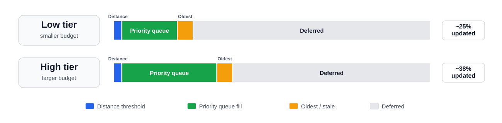

<h1 align="center">Real-Time Path Tracing in Games</h1>

<em>Best Practices for Performance and Scalability</em>

June 2026

## Abstract

Real-time path tracing in games is about spending a limited ray budget
where it contributes most to the final reconstructed frame. A shipping
renderer cannot rely on high ray counts or deep unbiased paths, so it
must balance rays across direct lighting, visibility, indirect lighting,
specular response, and cache updates. Caches, denoisers, and upscalers
are not support systems around the renderer; they are part of the
renderer.

This whitepaper focuses on D3D12/DXR-class hybrid renderers, with NVIDIA
RTX-oriented technologies used as concrete examples. Equivalent concepts
can apply to Vulkan ray tracing and other vendor paths, but
vendor-specific features require their own capability checks and
fallbacks. The target audience is rendering engineers and technical
artists.

## 1. Introduction

Path tracing approximates global illumination by stochastically tracing
light transport paths per pixel. Offline renderers improve quality by
adding samples and waiting longer for convergence. Game renderers do not
have that freedom: the lighting solution must fit inside a strict and
repeatable frame budget while the camera, animation, dynamic lighting,
streaming, and post-processing continue to run.

At 60 FPS, the total frame time is 16.67 ms. The path-traced rendering
slice is only part of that total, so the renderer must be designed
around scalable quality controls: adaptive ray allocation, radiance
caching, and feature-tier fallbacks.

Path-traced rendering must then be optimized as a complete pipeline. Ray
dispatch performance depends not only on ray count and traversal cost,
but also on shader divergence, any-hit work, material indirection,
memory bandwidth, register pressure, and instruction-cache behavior.
Total frame time must also account for acceleration-structure updates,
denoising, and upscaling, so all these systems need to be profiled and
tuned together.

For most shipping real-time renderers, primary visibility should
generally remain rasterized, since rasterization is still the most
efficient way to generate the G-buffer. However, for certain scene
types, primary rays may still be a viable option. Path tracing should be
applied where it provides the highest value: indirect lighting, complex
visibility, specular response, high-quality shadows, and radiance-cache
updates.

### Required performance data

The guidance in this document assumes that performance is measured per
preset and per platform. For each target setup, the engine should record
the metrics summarized in Table 1.

| Metric | Why it matters |
| :--- | :--- |
| Native render resolution and output resolution | Ray count, denoiser cost, and upscaler behavior depend on the internal resolution |
| Target FPS and frame-time budget | A technique that works at 30 FPS may be unusable at 60 or 120 FPS |
| Rays per pixel by signal | Direct lighting, visibility, indirect lighting, and cache updates each have a different value per ray |
| Maximum path depth and termination policy | Deep paths quickly increase cost, divergence, and live state |
| TLAS/BLAS build and update time | Dynamic scenes can fail because of update spikes even when ray dispatch is fast |
| Ray dispatch, denoising, and upscaling time | The player sees the final reconstructed frame, not an isolated pass |
| Memory footprint | Acceleration structures, radiance caches, and transient buffers can affect scalability |
| Temporal stability metrics | Persistent ghosting, history lag, disocclusion noise, and lighting pop are often more visible than single-frame error |

*Table 1. Required performance data*

### Starting ray-budget model

Budget rays by signal rather than by one global rays-per-pixel number.
Direct lighting visibility, diffuse GI, glossy/specular response,
volumetrics, and cache updates have different noise characteristics and
perceptual value. A low preset may rely heavily on caches and
reconstruction, while a high preset may add more light candidates, cache
updates, or occasional deep paths.

Each signal should have its own cost-control strategy:

- Direct lighting: prefer explicit light sampling, visibility rays and
  reuse good samples across pixels and frames; avoid relying on random
  path hits to find small lights.
- Specular and glossy: prioritize visible reflected detail, stable hit
  distance, correct specular motion; use bounded VNDF sampling as a
  solid baseline [14].
- Diffuse GI: prefer one shallow bounce plus radiance-cache fallback
  rather than per-pixel deep paths.
- Cache updates: run deeper or higher-quality paths at lower spatial
  frequency and amortize work over frames.
- Denoising and upscaling: validate the final reconstructed image,
  including jitter behavior and post-upscale artifacts, not only the
  pre-upscale denoised buffer.

## 2. Core Concepts Refresher

Path tracing estimates full light transport under strict real-time
constraints and must be evaluated by the quality of the final denoised
and upscaled image, not by idealized physical accuracy alone. Cost,
variance, bias, temporal stability, and reconstruction artifacts are all
part of that evaluation.

### Path tracing vs. ray tracing

Traditional real-time ray tracing often evaluates limited ray types such
as shadows, reflections, refractions, or ambient occlusion. Path tracing
samples complete light paths, allowing indirect illumination and energy
exchange between surfaces. The distinction is primarily computational:
path tracing solves a more complete transport problem, but with higher
cost and variance per sample.

### Monte Carlo integration under low sample count

Path tracing estimates the rendering equation using random or
low-discrepancy samples. With only a few rays per pixel, variance
dominates. Real-time convergence therefore depends less on raw sample
count and more on importance sampling, reuse, radiance caching, stable
temporal accumulation, confidence-driven denoising, and upscaling.

Avoid treating all high-energy samples as harmless convergence noise. A
rare physically plausible bright sample can be acceptable, but a rare
contribution caused by radiance divided by an extremely small PDF can
poison temporal and spatial denoisers. Values that would converge over
hundreds or thousands of samples often create visible fireflies in a
game where only a few frames of history are reliable.

### Physical accuracy and controlled bias

Real-time implementations intentionally trade unbiased accuracy for
stability and performance. Radiance caches, ReSTIR-style reuse, light
pruning, material simplification, texture MIP bias, temporal denoising,
and upscaling all introduce bias. The goal is not to eliminate bias; the
goal is to make it stable, predictable, visually plausible, and
artist-controllable.

A less physically exact solution that produces stable lighting at 60 FPS
can be preferable to a more exact solution that causes flickering,
ghosting, or misses the frame budget.

### Bias as a performance tool

- You can use bias by design and document where it enters the pipeline.
- Prefer bias that is low frequency, temporally stable, and hard for
  players to notice.
- Avoid bias that changes abruptly with camera motion or dynamic
  lighting.
- Validate biased techniques against a slower reference path for
  representative scenes, not only against isolated test cases.
- Avoid naive Russian roulette in low-spp paths. Deterministic depth
  limits, throughput thresholds, and validated radiance-cache
  termination are usually safer for real-time denoising.

## 3. Real-Time Feasibility and Feature Tiers

Real-time path tracing is feasible through the convergence of hardware
ray traversal, GPU-friendly scene data, coherent shader design, explicit
sampling, radiance reuse, and denoising. No single feature makes it
practical. Advanced features should be optional accelerators layered on
a baseline hybrid architecture.

### Capability tiers

Do not expose one binary path tracing mode. Expose feature tiers with
independent toggles for ray count, path depth, light candidates, cache
update rate, material LOD, AS policy, OMM, SER, denoising, and
upscaling.

| Tier | Core features | Use case |
| :--- | :--- | :--- |
| Baseline hybrid | Raster G-buffer, DXR TraceRay or RayQuery, simple visibility rays, temporal denoising | Maximum compatibility and first integration milestone |
| Shipping performance | RIS/ReSTIR-style direct and indirect lighting, AS compaction/refit, material LOD, radiance cache, NRD | Main real-time game target |
| Shipping RTX | SER, OMM, RTXDI, DLSS Ray Reconstruction, HitObject workflows, specialized RayQuery paths | Best RTX quality/performance path with appropriate fallbacks |
| Modern DXR | Clustered Geometry, Partitioned TLAS | Additional API-level path for finer BVH/RTAS management; not a separate hardware feature |

*Table 2. Capability tiers and deployment scope*

### Shader Execution Reordering

SER allows shader code to mark points where divergent workloads may be
regrouped for improved execution and data coherence. It is most useful
when rays hit complex materials, branch-heavy shading paths, or
incoherent secondary hit sets. Treat it as an optional optimization:
query support, isolate SER-enabled paths, and measure before/after in
representative content. SER also introduces HitObject-style workflows
[3], [4]. Use the smallest number of coherence-hint bits needed to
distinguish meaningful workload groups. Test several compact hint
configurations against a no-hint baseline, and keep extra bits only when
they produce consistent GPU-time improvements in representative content.

### Opacity Micromaps and alpha-tested content

Alpha-tested geometry such as foliage, fences, and hair cards can cause
large numbers of any-hit shader invocations. OMMs classify sub-triangle
opacity so known opaque or transparent regions can avoid expensive
any-hit work. They add preprocessing, memory, and resource-management
complexity; use them where any-hit cost is measurable and persistent
[5], [6]. Consider evaluating indirect rays with
`RAY_FLAG_FORCE_OMM_2_STATE`, as resolving unknown micromap states
without invoking any-hit shaders can provide meaningful performance
gains. Where the visual contribution of alpha-tested detail is likely to
be minimal, consider forcing those materials opaque as well,
particularly in performance-focused quality modes [15].

### Advanced RTAS features

Advanced acceleration-structure features such as Clustered Geometry and
Partitioned TLAS should be treated as optional scalability paths, not
baseline renderer requirements. Their purpose is to improve
acceleration-structure build, update, and streaming behavior for large
or highly dynamic scenes. These features require explicit capability
checks, SDK and driver validation, content-pipeline support, and a fully
functional fallback path using conventional BLAS/TLAS management.

## 4. Scene Design and Content Authoring

Path-traced performance is shaped by scene composition, not only
renderer code. Content that is harmless for rasterization can become
expensive for ray traversal, any-hit shaders, or denoiser stability. A
production renderer needs content rules that artists can see and debug.

### Structure scenes for BVH efficiency

Organize scene geometry so each BLAS has tight bounds and minimal empty
space. Static geometry should be grouped into spatially coherent chunks,
allowing rays to reject large parts of the scene quickly instead of
traversing through loose or overlapping bounds. Merge geometry when
objects are close together and share the same lifetime, update
frequency, material behavior, opacity behavior, and LOD policy. Split
geometry when a BLAS would otherwise contain large empty regions,
unrelated parts, mixed opaque and alpha-tested content, or objects that
require different update policies. Avoid asset layouts that create loose
BLAS bounds. Very long thin triangles, large thin surfaces, and dense
overlapping cards can cause rays to test more geometry than necessary.
Use profiling and BVH debug views to identify these cases, then clean up
the asset or split it into smaller spatial chunks where the benefit is
clear. Avoid automatic over-splitting, since extra chunks can increase
memory use, instance count, and build/update cost. Sky and infinite
environment lighting should be handled through the miss shader or
environment system, rather than being represented as giant TLAS geometry
[6], [13].

### Encourage ray termination

Scenes that let rays travel far through empty space waste traversal time
and increase variance. Interior walls, ceilings, terrain, and large
occluders naturally limit ray length. Large open worlds need explicit
fallback policies: sky models, environment probes, world-space radiance
caches, distance cutoffs, and lower-cost cache queries for rays that
exceed distance or bounce thresholds.

### Improve indirect transport through layout

Interior layouts can be optimized for indirect transport by making
important light paths easier to sample, such as windows, doorways,
bright openings, and major bounce regions. Ray guidance can use portals,
cache-guided sampling, light-selection hints, or similar aids to steer
rays toward useful transport paths.

Additional emissive geometry invisible to primary rays using instance
masks can approximate complex transport such as light entering windows,
adjacent-room contribution, or scattering-based secondary light sources.
These proxies can reduce noise and improve convergence, but they are
biased and should not be the starting point for scene design. First tune
the real lighting, sampling strategy, radiance-cache placement, cache
update rate, and cache invalidation behavior. Use emissive proxies only
when convergence or lighting response time still cannot meet the target
budget.

Emissive proxies work best for static content with stable lighting. Use
them with caution in dynamic lighting setups, time-of-day changes,
moving-door cases, or destructible scenes, where the proxy may no longer
match the real transport. Proxies should be validated against a
reference path and exposed as artist-controlled lighting aids, not
hidden hacks.

### Authoring checklist

- Separate opaque, alpha-tested, and blended content, but avoid
  unnecessary BLAS fragmentation.
- Use shared BLASes for local object groups that can be updated, culled,
  streamed, and LOD-selected together.
- Design proxies and batching that scales well with distance to keep
  TLAS instance count within budget.
- Plan dynamic geometry around BLAS updates, grouping, and proxies.
- Constrain dense animation, such as foliage wind, to patterns that
  scale in RT if they can reveal obvious raster/trace mismatch on
  screen.

## 5. Acceleration Structures and BVH Management

Acceleration-structure management policy is a high-impact performance
decision that should be well planned. The goal is to minimize traversal
cost, build/update spikes, memory footprint, and synchronization
overhead while keeping the scene representation accurate enough to
minimize potential issues in player-visible lighting.

### Merge/split decision rules

Merge and split decisions should follow the content-authoring checklist.

### Build, refit, rebuild, and compaction

For static BLASes, use a fast-trace build configuration and compact
after build. Static geometry pays the build cost once, so the runtime
goal should be high traversal quality and reduced memory footprint.

For dynamic meshes with stable topology and bounded deformation, prefer
the refit path when it preserves BVH quality. These BLASes should
generally use fast-trace settings and compaction. Do not assume that
refit will always be the best option; compare it against rebuild for
representative meshes, animation ranges and scene conditions.

For generic dynamic meshes with heavy deformation, large bounds changes,
or poor refit quality, favor fast-build/update-oriented settings. Use
refits when topology allows, with periodic rebuilds to restore BVH
quality and keep tracing performance consistent over time.

Batch AS builds, refits, and rebuilds to amortize dispatch cost, improve
GPU occupancy, and minimize barriers. Use async execution paths
overlapping AS maintenance with graphics to hide GPU underutilization
[6], [12].

### Importance-driven dynamic updates

For dynamic objects, prioritize per-frame updates of the most impactful
instances instead of distributing the update budget uniformly across the
active set of dynamic objects. GPU hit counters can be accumulated
during ray passes and read back asynchronously to prioritize updates.
This allows the system to focus updates on objects that contribute
strongly to visual fidelity, such as those casting near shadows,
reflections, or affecting key light paths, while deprioritizing
diffuse-only contributors. This allocates updates where they matter
most, improving both performance and perceptual quality.

Define the dynamic-update budget as both an instance limit and a
geometry-processing limit per frame. The priority queue should select
the highest-impact updates that fit within both budgets, so neither many
small instances nor a few large meshes can cause noticeable frame-time
spikes. Close-up objects should receive a distance-based priority boost,
regardless of size, visibility, or hit count, to prevent synchronization
artifacts in nearby views. Figure 1 illustrates an example scheduler.

*Figure 1. Illustrative priority-queue allocation for low- and high-tier
update budgets. Percentages are examples, not measured targets.*

### Advanced RTAS features

For scenes with many dynamic objects or large streamed regions, advanced
RTAS features can reduce the cost of rebuilding or partially updating
acceleration structures. Clustered Geometry can be useful when suitable
geometry can be represented through reusable CLAS templates, allowing
the renderer to rebuild dynamic or repeated geometry more cheaply than a
full BLAS rebuild. Partitioned TLAS can help large scenes update only
the regions or instance groups that changed.

Fallback requirements depend on platform scope. If all target hardware,
APIs, drivers, and vendors support the advanced RTAS path, or if the
renderer is scoped only to feature-capable hardware, a separate fallback
path may not be necessary. Otherwise, keep the feature behind capability
checks and maintain a conventional BLAS/TLAS path.

### Trade-off summary

**Pros**

- Good AS policy can reduce both traversal time and frame-time spikes.
- Hit-driven update prioritization connects cost directly to visible
  contribution.

**Cons**

- AS management becomes an engine subsystem with its own telemetry,
  scheduling, and QA needs.
- Overly aggressive refit policies or skipped AS updates can degrade
  tracing quality or introduce visual artifacts.

## 6. Geometry Data

Efficient geometry data layout is important for memory bandwidth, cache
behavior, and shader cost in ray tracing. Unlike rasterization,
secondary rays such as diffuse GI, glossy reflection, and shadow rays
often access geometry incoherently, so layouts optimized for raster
primary visibility can waste bandwidth and amplify latency.

Ray tracing shaders should treat geometry data as a minimal shading
record, not as a full raster vertex format. The intersection already
provides the instance ID, primitive ID, barycentrics, ray distance, and
transforms. The hit position usually does not need to be fetched from
vertex buffers because it can be reconstructed from the ray data. Vertex
positions should only be fetched when they are explicitly needed, for
example for custom geometric normals or special material effects.

### Data layout principles

- Split hot and cold attributes. Keep frequently used data such as
  packed normal data, UVs, tangent basis information in compact,
  cache-friendly records. Keep rarely used data such as secondary UV
  sets, vertex colors, or authoring attributes separately.
- Pack attributes and group those that are accessed together. Attribute
  records should minimize the number of memory transactions required for
  common hit shading.
- Specialize layouts by ray class if justified. Visibility rays may only
  need opacity information. Diffuse GI may need albedo and normal.
  Glossy rays may need a more complete material description. Different
  hit shader groups per ray type can help here.
- Limit the number of distinct data layouts. Standardize attribute sets
  where practical, and avoid arbitrary combinations of UV channels,
  tangent sets, or optional vertex data that increase shader variation
  and reduce execution coherence.
- Prefer structured or typed buffers. Byte-address buffers are still
  useful for variable-size records.
- Minimize dependent memory reads.
- Avoid control flow that depends on global memory fetches, particularly
  in any-hit and closest-hit shaders.
- Keep any-hit shaders extremely lightweight. Any-hit execution is
  especially sensitive to divergence and memory latency. Alpha-tested
  geometry should use compact opacity metadata paired with simplified
  alpha evaluation and OMMs if available.

### Ray tracing specialization examples

Although index buffers are typically shared between rasterization and
ray tracing pipelines, vertex attribute layouts can be specialized for
ray tracing workloads. Secondary rays (e.g., diffuse or specular
bounces) typically require fewer attributes than primary visibility, so
separating or compacting vertex data for these cases can reduce
bandwidth pressure. Compact encodings are particularly beneficial: for
example, normals and tangents can use octahedral encoding or other
SNORM-packed formats. The tangent basis can often be reconstructed from
the normal, a packed tangent angle, and a handedness bit. Position
attributes often do not need to be fetched explicitly, since the hit
position is already available from the ray–triangle intersection result.

Evaluate whether non-indexed geometry is beneficial for certain
workloads, as it allows primitive data to be stored in a compact
contiguous memory region while avoiding dependent index fetches and
reducing divergent memory access. This representation can also encode
additional per-primitive attributes, such as texel density, enabling
accurate MIP level evaluation without accessing position data.

## 7. Materials and RT Material LOD

Physically based rendering models remain important for consistency, but
a real-time path tracer needs material scalability. Secondary rays are
usually less coherent than primary raster shading, and faithfully
evaluating every material feature for every bounce is rarely affordable.

### Coarse specialization, not permutation explosion

Prefer a small number of coarse BRDF/BSDF classes evaluated by the
ray-generation path integrator. Closest-hit shaders should specialize
hit processing and return a compact surface record containing material
class, shading parameters, and geometric data. This lets ray-generation
shader manage bounce control, throughput, sampling, cache queries, and
termination without turning into a full material uber-shader [6].

### Material LOD for path tracing

| Ray or surface class | Recommended material detail |
| :--- | :--- |
| Primary visible surface | Full raster material, full normal map and texture stack as needed. |
| Near glossy/specular hit | High-quality BRDF and normal data to preserve stable, detailed reflections. Use screen-space material fallback when full hit shading is expensive or unavailable. |
| Diffuse secondary hit | Reduced BRDF, simplified normals, cache fallback when possible. |
| Cache-update hit | Evaluate a simplified diffuse-style material with conservative MIP selection. Exclude high-frequency texture, normal, or BRDF detail that the radiance cache cannot store or reproduce reliably |

*Table 3. Recommended material detail by ray or surface class*

### Selecting material LOD by ray type

Different ray types should select different material LOD hit groups. The
ray-generation shader chooses the ray class, while the shader table maps
that class to an appropriate hit group for each material family. Primary
and near-specular rays can use high-quality material evaluation; diffuse
secondary and cache-update rays can use simplified BRDFs, conservative
MIPs, and reduced texture access; shadow and visibility rays should use
minimal opacity handling and avoid closest-hit shading when possible.
This keeps material specialization in the hit path without forcing every
ray to pay for full material evaluation.

On Shader Model 6.9 / SER-capable paths, `dx::HitObject` can be used to
separate traversal from shader invocation. `HitObject::TraceRay()` returns
the hit result without immediately running closest-hit or miss shading;
ray-generation shader can then choose the appropriate shader-table
record for the current ray type and material LOD using
`HitObject::SetShaderTableIndex()`, optionally reorder the work, and invoke
the selected shader. This gives the integrator direct control over which
material-LOD hit group is executed, while preserving material
specialization in closest-hit shaders.

### Texture sampling and ray cones

Ray tracing does not naturally provide screen-space derivatives for
texture LOD. Estimate ray footprint using ray cones or equivalent
approximations. A per-mesh or per-instance scale factor can convert cone
radius at the hit point into an approximate texel footprint for MIP
level selection.

### Approximation policy

Material approximation should be ray-type aware and validated against
the final denoised and upscaled image. Compile each material into a
small set of RT-friendly variants such as full, simplified specular,
diffuse-secondary, and shadow-opacity.

Skip high-frequency normal or texture detail for rough, distant,
diffuse-secondary, or cache-update rays when it does not meaningfully
affect the final image. Cache-update passes can usually reuse a
diffuse-like material path, but with specialized ray generation for
better efficiency.

When full material evaluation is too expensive, use baked material
proxies for secondary rays.

Use simplified BRDFs for low-energy bounces, but preserve albedo,
Fresnel, metallic, and roughness behavior so simplified materials do not
become visibly brighter, sharper, or unstable.

### Trade-off summary

**Pros**

- Material LOD reduces latency, bandwidth, and shader instruction
  pressure.
- Coarse material classes make SBT and pipeline management more
  predictable.

**Cons**

- Simplified secondary shading can produce visible mismatch in mirrors
  and glossy surfaces.
- Too few material classes can recreate the uber-shader problem inside
  one code path.

## 8. Efficient Sampling Techniques

Sampling determines whether the renderer spends rays on valuable light
paths or wastes them on high-variance estimates. In real time, sampling
must be designed together with temporal reuse and reconstruction. A
sampling method that looks unbiased in one frame may be unacceptable if
it creates unstable noise that denoisers cannot track.

### Direct illumination

Use Next Event Estimation (NEE) during lighting evaluation: explicitly
sample lights at opaque surface hits rather than hoping paths randomly
intersect them. Area lights should be represented by well-defined
emissive surfaces that the path tracer can sample directly. This gives
the renderer predictable data for light selection, PDF evaluation,
visibility testing, and temporal or spatial reuse. For glossy materials
with narrow specular lobes, combine light sampling with BSDF or VNDF
sampling using Multiple Importance Sampling (MIS).

Adaptive NEE techniques such as NEE-AT improve light selection using
feedback from previously observed lighting contributions. Instead of
relying only on uniform or power-weighted sampling, they increase the
probability of selecting lights that were useful for nearby pixels or
recent frames. A global distribution should still be retained so new,
moving, or previously occluded lights can be discovered and so sampling
remains robust when local history is not relevant [7].

### Many-light sampling

In scenes with many light sources, naïve light selection becomes
inefficient because each shading point may need to choose from a very
large light set. Resampled Importance Sampling improves scalability by
drawing a small candidate set, weighting those candidates by estimated
contribution, and selecting a representative sample. ReSTIR extends this
idea with reservoir-based temporal and spatial resampling so useful
direct-light samples can be reused across pixels and frames [9].

For direct lighting on camera-visible surfaces, tiled or clustered light
culling can provide screen-space or camera-frustum light lists for RIS,
adaptive NEE or ReSTIR DI. These lists work well for primary shading
because shaded points map naturally to screen tiles or clustered frustum
cells. They should not be treated as the main solution for secondary or
indirect path hits, where the receiver may be off-screen, behind the
camera, or unrelated to the primary pixel’s tile.

For secondary and indirect hits, use a world-space light-sampling
structure. A camera-relative reservoir grid, ReGIR-style light grid, or
sparse hash grid can provide candidates based on the receiver’s
world-space location rather than its screen position. RTXDI’s ReGIR
path, for example, uses world-space light-grid construction and light
weighting for surfaces or volumes.

A sparse world-space hash grid can follow the same spatial-hashing idea
used by SHaRC, but store light-sampling data instead of radiance-cache
data. SHaRC uses a spatially hashed world-space radiance cache with hash
entries and accumulated/resolved radiance buffers; for many-light
sampling, a similar hash-grid layout can store candidate light IDs,
per-cell reservoirs, importance summaries, or coarse visibility history.

Only active or recently used world-space cells need to be stored in the
hash table. Lights are inserted into cells overlapped by their influence
bounds or estimated contribution, while shading points query their local
cell and optionally nearby cells to obtain candidates. This keeps
candidate generation sparse, streaming-friendly, and more stable for
off-screen secondary hits than purely screen-space lists.

The grid or reservoir data should remain a proposal mechanism, not a
substitute for final lighting evaluation. The selected candidate still
needs to be evaluated at the actual shading point using the correct PDF
or reservoir weight, material response, and full-scene visibility.

### Dominant lights and environment sampling

Do not force all light types through one generic sampler. Sun, moon, and
strong directional emitters often benefit from dedicated sampling paths.
Separating dominant and secondary lights can reduce variance and improve
temporal stability.

### Sampling many emissive surfaces

For scenes with many emissive surfaces, maintain a separate
emissive-light sampling structure alongside the main TLAS. It should
contain only emissive primitives or analytic proxies plus sampling data
such as bounds, power, area, directionality, material IDs, and weights.
The structure is used for direct-light candidate generation, not
occlusion.\
At each shading point, sample a small preset-dependent number of
candidates from this structure. RIS or ReSTIR can keep a representative
candidate using correct probabilities or reservoir weights. The selected
candidate must still be tested with a visibility ray through the main
TLAS, and final lighting must use the real shading point, selected
emitter sample, material response, and full-scene visibility.\
This is useful for many emissive surfaces and for lights that are
difficult to track as explicit analytic lights, such as emissive meshes,
signs, animated VFX emitters, or procedural emissive materials.

### Denoiser-aware sampling

- Prefer stable low-frequency noise over high-frequency flicker.
- Avoid pathological samples where contribution is dominated by radiance
  divided by a tiny PDF.
- Clamp or regularize pathological PDF cases before they poison history.
- Avoid naive Russian roulette in low-rpp gameplay paths.
- Use deterministic depth/throughput limits plus radiance-cache
  termination when cache validity is high.
- Randomize spatial/temporal reuse patterns enough to avoid structured
  correlations, especially in ReSTIR-style neighbor sampling.

### Trade-off summary

**Pros**

- Explicit sampling and ReSTIR-style reuse improve quality at low ray
  counts.
- Dominant-light, environment, and emissive-light sampling paths provide
  predictable variance control.
- Emissive-light structures make mesh emitters and hard-to-track
  practical lights directly sampleable.

**Cons**

- ReSTIR-style reuse introduces noticeable overhead, potential bias, and
  requires careful validation.
- More sophisticated sampling increases implementation complexity and
  debugging burden.

## 9. Light Transport Optimization

Multi-bounce path tracing is often where brute-force approaches become
expensive first, but brute force is not always wrong. For constrained
content, limited path depth, high-end presets, or simpler integration
paths, a straightforward brute-force solution can be a valid choice
because it is predictable, scalable by ray count, and easier to
validate. Real-time engines should still be designed to scale beyond
that baseline using a hierarchy of direct lighting, shallow paths,
radiance caches, and controlled pruning.

### Radiance caching

Radiance caches store approximations of outgoing radiance in world space
or another stable domain. They allow low-frequency indirect lighting to
be reused across pixels, frames, and paths. SHaRC-style caches and
NRC-style neural caches can be integrated with path tracing so the
renderer evaluates a hit point and queries cached radiance instead of
continuing every path deeply [10].

### Cache update policy

- Update cache records using the same signals that drive sampling and
  shading work, with more frequent updates near the camera, around
  dynamic lights, and in regions with high lighting variance.
- Use confidence metrics from temporal accumulation to detect stale
  history and trigger cache resets or faster refresh rates when needed.
- Cache update passes often capture low-frequency indirect lighting. In
  those passes, dense alpha-tested geometry such as foliage can
  sometimes be simplified, treated as opaque, omitted at distance, or
  represented by proxy geometry. This reduces traversal cost but should
  be validated against scenes where foliage strongly affects lighting
  color or occlusion.

### Environment map and portals

For dynamic sky lighting, generate a low-resolution environment map from
procedural sky, atmosphere, clouds, moon, and sun-adjacent scattering.
Use it for environment sampling, radiance-cache updates, and
indirect-light queries while the full sky/cloud renderer remains
responsible for final background rendering.

Portal lights can reduce variance in interiors where most environment
contribution enters through windows or doorways. They are scene-specific
guides, not a universal replacement for light sampling. Portals should
match real openings, update when doors or shutters move, and be
validated against an unguided reference path.

### Pruning negligible contribution

Establish explicit energy, PDF, distance, and throughput thresholds for
skipping lights or indirect samples. Expose thresholds as scalability
controls. Low presets can prune distant emissives, tiny lights, and deep
low-energy paths aggressively; high presets can relax thresholds for
improved stability and accuracy.

### Trade-off summary

**Pros**

- Radiance caching is one of the strongest tools for making multi-bounce
  lighting practical in games.
- Per-frame baked environment maps enable efficient importance sampling
  of dynamic sky and cloud lighting.
- Pruning and cache update rate provide clean quality/performance
  controls.

**Cons**

- Caches can fall behind dynamic changes, causing lighting lag.
- Portal and proxy systems add authoring overhead and tuning.

## 10. Denoising and Ray Reconstruction

Denoising is part of the renderer, not a final polish pass. The path
tracer should be designed from the beginning to feed denoisers and
neural reconstruction with stable, labeled, demodulated signals and
reliable guide buffers.

### Baseline denoiser integration

Integrate a proven denoiser early to establish a quality/performance
baseline. NRD is an API-agnostic spatiotemporal denoising library
targeting low path-per-pixel signals and uses G-buffer guides such as
normal, roughness, hit distance, and motion vectors [8].

### Temporal accumulation policy

Rely on temporal accumulation where the scene is stable, but
aggressively reject or reduce history for camera cuts, disocclusion,
lighting changes, and cache invalidation. A confidence signal should be
driven explicitly by the renderer.

History confidence can be computed within passes like SHaRC updates for
better hardware utilization, providing a simple and robust mechanism for
evaluating temporal reliability and guiding accumulation behavior.
NVIDIA NRD exposes dedicated history-confidence inputs for this purpose,
allowing the renderer to explicitly communicate temporal validity to the
denoiser [8].

### DLSS Ray Reconstruction

DLSS Ray Reconstruction can replace multiple hand-tuned denoisers with
an AI reconstruction path in supported RTX configurations, generating
higher-quality pixels for sampled rays. It should be integrated as a
feature tier with fallback denoisers [11].

Spatial effects like SSS, blurred glass, refraction, and transparent VFX
may need additional guide buffers or dedicated composition order to
reconstruct correctly. Some effects may require engine-specific
guide-buffer remapping. For example, emissive colors may need to be
encoded into diffuse or specular albedo.

ReSTIR-style temporal and spatial reuse should be decorrelated before
reconstruction. Randomize previous-frame reservoir selection, neighbor
offsets, or reuse patterns to avoid stable correlations, crawling grids,
and repeated structured error entering DLSS-RR.

### Failure modes to test

- Camera cuts and fast rotations.
- Disocclusion behind foreground objects and thin geometry.
- Particles, decals, transparent surfaces, blurred glass, SSS, and depth
  of field.
- Lights toggling and flickering.
- Thin geometry in motion.
- Animated emissives and dynamic environment lighting.

## 11. Shader Optimizations

Shader design directly affects real-time path-tracing efficiency. Path
tracing has more divergence and more live state than many raster
workloads [16]. Excessive register pressure reduces occupancy, large
shader bodies stress instruction caches, and heavy material permutations
increase SBT and pipeline-management cost.

### Primary shader goals

- Keep ray payloads small and pack path state.
- Minimize live variables across TraceRay or RayQuery calls.
- Move common code out of hit and miss shaders where possible.
- Avoid duplicate material code while also avoiding divergent
  uber-shaders.
- Measure register count, occupancy, active threads per warp,
  instruction-cache behavior.

### Payload access and live ranges

Use payload access qualifiers where available to tell the compiler which
shaders read or write each payload field. This can reduce register
pressure and spilling by making payload lifetime and access semantics
explicit. Structure shader code with narrow scopes so temporary
variables do not remain live across trace calls. Nsight Graphics Shader
profiler should be used for inspection of live register usage.

### SER and coherence

Use SER where profiling shows divergence-heavy ray workloads benefit
from reordering. Good candidates include multi-material secondary hits.
SER is not a substitute for reducing divergence at the material-system
level; it is an additional coherence tool [3], [4]. Active threads
per warp views in Nsight Graphics GPU Trace are useful for finding the
shader lines where divergence becomes severe.

### Precision and packing

Use FP16 for values that remain resident in registers and do not need
FP32 dynamic range, such as selected material factors, roughness
intermediates, path-throughput components, or compacted radiance data.
Avoid excessive FP16/FP32 conversion paths. Store flags, ray types and
some intermediate material data in packed integer bitfields.

Use native FP16 types where precision allows, but do not assume they
automatically improve scalar ALU throughput. The main benefits are
smaller data footprint, reduced bandwidth and lower register pressure on
critical paths.

### Instruction-cache and loop-unrolling validation

Review generated shader code to ensure loops are not being unnecessarily
unrolled by compiler heuristics or explicit unroll directives. Excessive
unrolling can significantly increase shader body size, stress the
instruction cache, increase compile time, and worsen occupancy by
extending live ranges. This is especially important for loops over
lights, RIS/ReSTIR candidates, BSDF lobes, material layers, texture
layers, shadow rays, or path bounces.

### Shader review checklist

| Check | Question |
| :--- | :--- |
| Payload size | Can any field be packed or recomputed? |
| Live state | Are large variables kept alive across trace calls? |
| Permutation count | Does specialization reduce divergence or just duplicate code? |
| Any-hit cost | Can content be opaque, split, converted to OMM, or simplified? |
| Material indirection | How many dependent memory reads happen before useful shading? |
| SER benefit | Does measured coherence improve enough to justify the path? |

*Table 4. Shader review checklist*

## 12. TraceRay() vs. RayQuery(): Choosing the Right Tracing Model

TraceRay and RayQuery are both first-class DXR mechanisms. Neither is
universally faster. The right choice depends on SBT complexity, shader
structure, visibility requirements, and whether tracing should be
integrated into raster/compute shaders or a raytracing pipeline.

### TraceRay guidance

TraceRay is appropriate when full hit-group evaluation, programmable
closest-hit/any-hit logic, material dispatch, and SBT-controlled shader
selection are central to the workload. Keep SBT entries compact, use as
few state objects as practical for each pass, set payload size and
attribute size as low as possible [1], [6].

### RayQuery guidance

RayQuery operates inline within the caller shader. It is well suited for
local visibility, shadow rays, cache visibility, early termination
checks, and simple traversal queries where full material dispatch is
unnecessary. However, large inline material shading can turn into an
uber-shader with poor divergence and register behavior [1], [6].

### Mixed model

A practical renderer can use both mechanisms. RayQuery fits lightweight
visibility, occlusion, and cache checks in raster, compute,
ray-generation, or closest-hit shaders. TraceRay fits path-tracing
passes that need hit groups, SBT-controlled dispatch, closest-hit logic,
and richer material evaluation.

### Trade-off summary

**Pros**

- Using both models gives extra flexibility.
- RayQuery can reduce SBT pressure for lightweight queries.

**Cons**

- Maintaining two tracing styles can create duplicated logic and
  inconsistent behavior.
- Inline RayQuery paths can become difficult to optimize if they
  accumulate too much material code.

## 13. Debugging and Validation

Real-time path tracing needs dedicated debugging and validation. API
correctness, traversal efficiency, shader cost, denoiser quality, and
content authoring must all be visible. The engine should include
validation modes from the first integration milestone, not after
problems appear.

### Driver and API validation

Use vendor validation extensions and API debug layers during
development. NVIDIA ray tracing validation for DirectX 12 and Vulkan can
catch issues that are difficult to diagnose through normal debug layers,
including invalid SBT entries, payload mismatches, invalid
acceleration-structure operations, and malformed geometry inputs [12].

### Required debug views

| Debug view | Purpose |
| :--- | :--- |
| Rays per pixel by signal | Find budget spikes and signal imbalance |
| Path depth and termination reason | Identify runaway paths and over-aggressive pruning |
| Any-hit invocation count | Expose alpha-tested content and missing opaque flags |
| TLAS/BLAS build time | Catch dynamic-scene update spikes and streaming issues |
| Material shader cost heatmap | Find divergent or expensive materials |
| SER before/after timing | Prove that reordering improves the actual workload |
| Memory breakdown | Track AS, denoiser, cache, texture, and transient-buffer pressure. |

*Table 5. Required path-tracing debug views*

### Timer instrumentation and heatmaps

Per-pixel timing heatmaps are especially effective for ray tracing
because they reveal expensive geometry, material hotspots, missing
opaque flags, and traversal bottlenecks during live gameplay. DXR shader
timer instrumentation is a practical way to visualize TraceRay cost
directly in the frame [13].

### Detached camera and fixed-LOD validation

Validate BVH updates using a detached scene camera while keeping LODs
fixed as if rendering from the original viewpoint. This reveals cases
where update policy, LOD selection, or streaming decisions produce
incorrect behavior.

### Shipping gate

- Every preset must log frame time split by AS updates, ray dispatches,
  denoising, and cache work.
- Every content benchmark must include at least one alpha-heavy scene,
  one dynamic-light scene, one glossy interior, and one open-world scene
  if applicable.
- Every denoiser/reconstruction path must be tested under camera cuts,
  fast motion, and dynamic lighting.
- Every advanced feature path must be compared against its fallback path
  for both performance and artifacts.

### Trade-off summary

**Pros**

- Good instrumentation shortens optimization cycles and makes content
  problems visible.
- Driver-level validation and timer heatmaps catch classes of bugs that
  are hard to infer from frame captures alone.

**Cons**

- Instrumentation adds code complexity and may require vendor-specific
  paths.
- Validation and heatmap modes have overhead and should not be confused
  with shipping performance.

## 14. Case Studies

### SHaRC Update regime optimization

Initial SHaRC Update profile - RTXGI2 path tracing sample on RTX 5090 at
1920 × 1080 native resolution. Figure 2 shows the initial occupancy
profile and Table 6 summarizes the reported timings.

*Figure 2. Initial SHaRC Update occupancy profile*

| Configuration | Whole Frame | Dispatch Rays | SHaRC Update | SHaRC Query | Improvement vs Baseline | Speedup |
| :--- | :---: | :---: | :---: | :---: | :---: | :---: |
| Baseline reference | 4.30&nbsp;ms | 3.91&nbsp;ms | — | — | — | 1.00× |
| Baseline + SHaRC | 3.69&nbsp;ms | — | 0.69&nbsp;ms | 2.56&nbsp;ms | 14.2% | 1.17× |
| Baseline reference + SER | 3.78&nbsp;ms | 3.40&nbsp;ms | — | — | 12.1% | 1.14× |
| Baseline + SHaRC + SER | 3.31&nbsp;ms | — | 0.69&nbsp;ms | 2.16&nbsp;ms | 23.0% | 1.30× |
| **Baseline + SHaRC + SER + Force Opaque on SHaRC Update** | **2.95&nbsp;ms** | **—** | **0.31&nbsp;ms** | **2.19&nbsp;ms** | **31.4%** | **1.46×** |

*Table 6. SHaRC and SER timing comparison on the measured scene*

In the initial sample configuration SER improved the SHaRC Query pass
but did not improve SHaRC Update. SHaRC Query dropped from 2.56 ms to
2.16 ms, while SHaRC Update remained at 0.69 ms. Profiling showed that
the Update pass did not provide enough GPU utilization and was dominated
by long-latency any-hit shader execution. Adding
`RAY_FLAG_FORCE_OPAQUE` to the SHaRC Update rays removed that any-hit
workload, reducing Update time from 0.69 ms to 0.31 ms. In this scene,
the change also improved Active Threads per Warp and approximately
doubled SM Warp Occupancy. Adding OMM support should target the same
bottleneck by reducing any-hit shader execution for alpha-tested
geometry, while preserving more accurate opacity behavior than forcing
all traced geometry opaque. The expected effect is the same - fewer
any-hit invocations, but the magnitude depends on OMM coverage.

*Figure 3. SHaRC Update occupancy after SER and `RAY_FLAG_FORCE_OPAQUE`*

### Static scene BLAS flattening

This experiment is an intentionally extreme example - merging as many
BLASes as possible - to illustrate the potential performance speedup
from reducing TLAS complexity and traversal overhead. In a real-world
renderer, this optimization would preferably be performed offline, using
spatial proximity and traversal-cost analysis to create high-quality,
spatially coherent BLAS clusters.

**Baseline:** 14.7 ms (368K samples for Ray Tracing Traversal)\
**Flattened:** 11.4 ms (234K samples for Ray Tracing Traversal)

The flattened configuration reduced frame time from 14.7 ms to 11.4 ms,
a 3.3 ms (22%) improvement. “Ray Tracing Traversal” samples decreased
from 368K to 234K, a reduction of 134K (36%), demonstrating the
potential benefit of lowering TLAS complexity through BLAS
consolidation.

## 15. Conclusion

Real-time path tracing in games is practical when it is designed as a
performance-bounded reconstruction system. The highest-impact
optimizations are usually not higher sample counts, but better
allocation of rays, reduced traversal waste, coherent material shading,
scalable acceleration-structure updates, radiance caching,
denoiser-aware signal generation, and robust validation.

A shipping renderer should expose independent quality controls for ray
count, light candidates, cache update rate, path depth, material
simplification, AS update policy, OMM/SER usage, denoising, and
upscaling. These controls should be tied to measured frame time and
visual acceptance criteria rather than fixed assumptions about hardware.
Advanced features should improve the high-end path without weakening the
portable baseline.

Not every technique described in this document must be implemented in
its most advanced form before a game can ship with path tracing. Some
projects may require polished, state-of-the-art solutions to meet their
visual or performance goals, while others can achieve a strong practical
result with simpler implementations focused on the most important
problems. The appropriate level of complexity depends on the content,
target hardware, frame-time budget, and expected image quality.

The goal is not perfect physical accuracy or maximum technical
sophistication. The goal is stable, responsive, high-quality lighting
that fits the player’s frame-time budget, scales predictably across
presets, and provides clear diagnostics when artifacts appear.

## References

**[1]** [Microsoft DirectX Raytracing (DXR) Functional
Spec](https://microsoft.github.io/DirectX-Specs/d3d/Raytracing.html) -
DXR concepts, TraceRay, RayQuery, payload access qualifiers, OMM, and
raytracing tiers.

**[2]** [Microsoft DXR Functional Spec, Part
2](https://microsoft.github.io/DirectX-Specs/d3d/Raytracing2.html) -
Clustered Geometry, Partitioned TLAS, and indirect RTAS operation
details.

**[3]** [Microsoft DirectX Developer Blog: D3D12 Shader Execution
Reordering](https://devblogs.microsoft.com/directx/shader-execution-reordering/) -
SER release notes, Shader Model 6.9 context, and support guidance.

**[4]** [Microsoft DirectX Developer Blog: Announcing Shader Model
6.9 Retail and New D3D12
Improvements](https://devblogs.microsoft.com/directx/shader-model-6-9-retail-and-more/) -
Agility SDK and Shader Model 6.9 feature release context.

**[5]** [Microsoft DirectX Developer Blog: D3D12 Opacity
Micromaps](https://devblogs.microsoft.com/directx/d3d12-opacity-micromaps) -
OMM motivation, formats, BLAS linkage, and feature checks.

**[6]** [NVIDIA Technical Blog: Best Practices for Using NVIDIA RTX
Ray
Tracing](https://developer.nvidia.com/blog/best-practices-for-using-nvidia-rtx-ray-tracing-updated/) -
AS organization, opaque flags, payload size, divergence, hit shading,
and pipeline advice.

**[7]** [NVIDIA-RTX
RTXPT](https://github.com/NVIDIA-RTX/RTXPT) - Real-time path tracing
sample with NRD, RTXDI, OMM, SER, DLSS Ray Reconstruction, and presets.

**[8]** [NVIDIA-RTX NRD](https://github.com/NVIDIA-RTX/NRD) -
Real-time denoising library, guide buffers, denoiser setup and
integration notes.

**[9]** [NVIDIA-RTX
RTXDI](https://github.com/NVIDIA-RTX/RTXDI) - ReSTIR direct
illumination, ReSTIR GI, and ReSTIR PT implementation framework.

**[10]** [NVIDIA-RTX
RTXGI](https://github.com/NVIDIA-RTX/RTXGI) - SHaRC and NRC
world-space radiance cache examples for path tracing.

**[11]** [NVIDIA DLSS Developer
Page](https://developer.nvidia.com/rtx/dlss) - DLSS Super
Resolution, Ray Reconstruction, and Streamline integration overview.

**[12]** [NVIDIA Technical Blog: Ray Tracing Validation for DirectX
12 and
Vulkan](https://developer.nvidia.com/blog/ray-tracing-validation-at-the-driver-level/) -
Driver-level ray tracing validation for hard-to-debug RT errors and AS
issues.

**[13]** [NVIDIA Technical Blog: Profiling DXR Shaders with Timer
Instrumentation](https://developer.nvidia.com/blog/profiling-dxr-shaders-with-timer-instrumentation/) -
Per-pixel timing heatmaps and shader timer instrumentation.

**[14]** [Bounded VNDF Sampling for Smith–GGX
Reflections](https://gpuopen.com/download/publications/Bounded_VNDF_Sampling_for_Smith-GGX_Reflections.pdf)

**[15]** [Path Tracing Optimizations in Indiana Jones™: Opacity
MicroMaps and Compaction of Dynamic
BLASs](https://developer.nvidia.com/blog/path-tracing-optimizations-in-indiana-jones-opacity-micromaps-and-compaction-of-dynamic-blass/) -
Alpha testing in RT shaders.

**[16]** [Path Tracing Optimization in Indiana Jones™: Shader
Execution Reordering and Live State
Reductions](https://developer.nvidia.com/blog/path-tracing-optimization-in-indiana-jones-shader-execution-reordering-and-live-state-reductions)
