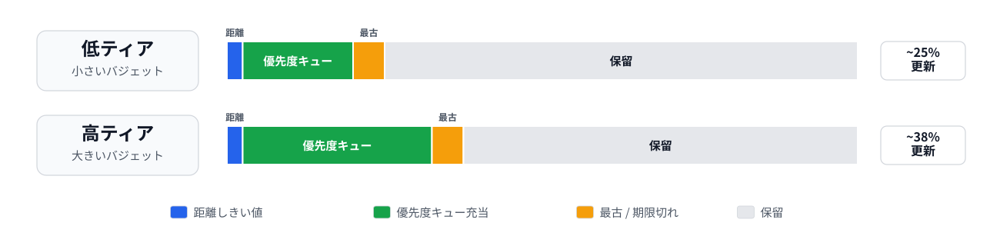

<h1 align="center">ゲームにおけるリアルタイム・パストレーシング</h1>

<em>パフォーマンスとスケーラビリティのベストプラクティス</em>

2026年6月

## 概要

ゲームにおけるリアルタイム パス
トレーシングでは、限られたレイ予算を、最終的に再構成されるフレームへの寄与が最も大きい箇所に割り当てる必要があります。製品版レンダラーは、多数のレイや深い不偏パスに頼ることができないため、直接ライティング、可視性、間接ライティング、スペキュラ応答、キャッシュ更新の間でレイの配分を調整する必要があります。キャッシュ、デノイザー、アップスケーラーは、レンダラーを取り巻く補助システムではなく、レンダラーそのものの一部です。

本ホワイトペーパーでは、NVIDIA
RTX向けテクノロジを具体例として用いながら、D3D12/DXRクラスのハイブリッド
レンダラーに焦点を当てます。同等の概念はVulkanレイ
トレーシングや他ベンダー向けの実装にも適用できますが、ベンダー固有機能には、それぞれに応じた機能サポートの確認とフォールバックが必要です。対象読者は、レンダリング
エンジニアとテクニカル アーティストです。

## 1. はじめに

パス
トレーシングは、ピクセルごとに光輸送パスを確率的に追跡することで、グローバル
イルミネーションを近似します。オフライン
レンダラーは、サンプルを追加し、収束までの時間を長く取ることで品質を向上させます。一方で、ゲーム
レンダラーにはそのような余裕はありません。カメラ、アニメーション、動的ライティング、ストリーミング、ポストプロセスの実行を継続しながら、厳格かつ再現可能なフレーム予算内にライティング
ソリューションを収める必要があります。

60 FPSでは、総フレーム時間は16.67 msです。パス
トレーシングによるレンダリングが占めるのは、その一部にすぎません。そのためレンダラーは、適応的なレイ割り当て、ラディアンス
キャッシュ、機能ティア別のフォールバックといった、スケーラブルな品質制御を中心に設計する必要があります。

したがって、パス トレーシング
レンダリングは、パイプライン全体として最適化する必要があります。レイ
ディスパッチのパフォーマンスは、レイ数とレイ トラバーサル
コストだけでなく、シェーダーの分岐、any-hit処理、マテリアルの間接参照、メモリ帯域幅、レジスタ
プレッシャー、命令キャッシュの挙動にも左右されます。総フレーム時間には、アクセラレーション構造の更新、ノイズ除去、アップスケーリングも含めなければならないため、これらすべてのシステムをまとめてプロファイリングし、チューニングする必要があります。

製品版のリアルタイム
レンダラーの大半では、G-bufferを生成する最も効率的な方法は依然としてラスタライザーを使用することであるため、プライマリ可視性にも通常はそのままラスタライザーを用いるべきです。ただし、一部のシーン
タイプでは、プライマリ
レイが引き続き有効な選択肢となる場合もあります。パス
トレーシングは、間接ライティング、複雑な可視性、スペキュラ応答、高品質なシャドウ、ラディアンス
キャッシュの更新など、最も高い価値を提供する箇所に適用するべきです。

### 必須のパフォーマンス データ

本書のガイダンスでは、プリセット別およびプラットフォーム別にパフォーマンスが測定されることを前提としています。各ターゲット構成について、エンジンは表1にまとめた指標を記録する必要があります。

| 指標 | 重要な理由 |
| :--- | :--- |
| ネイティブ レンダリング解像度と出力解像度 | レイ数、デノイザーのコスト、アップスケーラーの挙動は内部解像度に依存するため |
| 目標FPSとフレーム時間予算 | 30 FPSで機能する手法が、60 FPSまたは120 FPSでは使用できない場合があるため |
| 信号別の1ピクセルあたりのレイ数 | 直接ライティング、可視性、間接ライティング、キャッシュ更新では、それぞれレイ1本あたりの価値が異なるため |
| 最大パス深度と終了ポリシー | 深いパスでは、コスト、分岐、実行中に保持する状態が急速に増加するため |
| TLAS/BLASのビルド時間と更新時間 | レイ ディスパッチが高速でも、動的シーンでは更新時のスパイクが原因で問題が生じる可能性があるため |
| レイ ディスパッチ、ノイズ除去、アップスケーリングの所要時間 | プレイヤーが目にするのは、独立したパスではなく、最終的に再構成されたフレームであるため |
| メモリ フットプリント | アクセラレーション構造、ラディアンス キャッシュ、一時バッファがスケーラビリティに影響を与える可能性があるため |
| 時間的安定性の指標 | 持続的なゴースト、ヒストリの遅延、ディスオクルージョン ノイズ、ライティングのポップは、多くの場合、単一フレームの誤差よりも目立つため |

*表1. 必須のパフォーマンス データ*

### 初期レイ予算モデル

1つのグローバルな1ピクセルあたりのレイ数ではなく、信号別にレイの予算を設定します。直接ライティングの可視性、ディフューズGI、グロッシー／スペキュラ応答、ボリューメトリクス、キャッシュ更新は、それぞれ異なるノイズ特性と知覚上の価値を持ちます。低品質プリセットではキャッシュと再構成への依存度を高め、高品質プリセットではライト候補、キャッシュ更新、または時折使用する深いパスを増やすことができます。

各信号には、固有のコスト制御戦略を用意する必要があります。

- 直接ライティング：明示的なライト
  サンプリングと可視性レイを優先し、良好なサンプルをピクセル間およびフレーム間で再利用します。小さなライトを見つけるために、ランダムなパス
  ヒットに依存しないようにします。
- スペキュラとグロッシー：可視の反射ディテール、安定したヒット距離、正確なスペキュラ
  モーションを優先します。堅実なベースラインとして、範囲を制限したVNDFサンプリングを使用します[14]。
- ディフューズGI：ピクセルごとの深いパスではなく、浅い1バウンスとラディアンス
  キャッシュのフォールバックを優先します。
- キャッシュ更新：より少ない空間サンプル数で、より深いパスまたは高品質なパスを実行し、処理を複数フレームにわたって償却します。
- ノイズ除去とアップスケーリング：アップスケーリング前のノイズ除去済みバッファだけでなく、ジッターの挙動やアップスケーリング後のアーティファクトを含む、最終的に再構成された画像を検証します。

## 2. 主要概念の再確認

パス
トレーシングは、厳しいリアルタイム制約の下で光輸送全体を推定するものであり、理想化された物理的精度だけでなく、最終的にノイズ除去およびアップスケーリングされた画像の品質で評価する必要があります。コスト、分散、バイアス、時間的安定性、再構成アーティファクトのすべてが、その評価に含まれます。

### パス トレーシングとレイ トレーシング

従来のリアルタイム レイ
トレーシングでは、シャドウ、反射、屈折、アンビエント
オクルージョンなど、限定された種類のレイを評価することが一般的です。パス
トレーシングでは完全な光路をサンプリングするため、間接照明とサーフェス間のエネルギー交換を扱えます。両者の違いは主として計算量にあります。パス
トレーシングはより完全な光輸送問題を解きますが、サンプルあたりのコストと分散は高くなります。

### 少ないサンプル数でのモンテカルロ積分

パス トレーシングは、ランダム
サンプルまたは低食い違いサンプルを使用してレンダリング方程式を推定します。1ピクセルあたり数本のレイしか使用できない場合は、分散が支配的になります。そのため、リアルタイムでの収束は、単純なサンプル数よりも、重点的サンプリング、再利用、ラディアンス
キャッシュ、安定した時間的蓄積、信頼度駆動型のノイズ除去、アップスケーリングに大きく依存します。

高エネルギーのサンプルをすべて無害な収束ノイズとして扱わないでください。まれに発生する、物理的に妥当な明るいサンプルは許容できる場合がありますが、極端に小さいPDFでラディアンスを除算した結果として生じるまれな寄与は、時間的および空間的デノイザーを破綻させる可能性があります。数百または数千サンプルであれば収束する値でも、信頼できるヒストリが数フレーム分しかないゲームでは、目立つファイアフライを生じることがよくあります。

### 物理的精度と制御されたバイアス

リアルタイム実装では、安定性とパフォーマンスを得るために、不偏性を意図的に犠牲にします。ラディアンス
キャッシュ、ReSTIR方式の再利用、ライトの枝刈り、マテリアルの簡略化、テクスチャのMIPバイアス、時間的ノイズ除去、アップスケーリングは、いずれもバイアスを導入します。目標はバイアスを排除することではなく、安定して予測可能で、視覚的に妥当かつアーティストが制御できるものにすることです。

60
FPSで安定したライティングを生成できる物理的精度の低いソリューションの方が、より正確でも、ちらつきやゴーストを引き起こしたり、フレーム予算を超過したりするソリューションよりも望ましい場合があります。

### パフォーマンス ツールとしてのバイアス

- バイアスは設計上の手段として利用でき、パイプラインのどこで導入されるかを明記できます。
- 低周波で時間的に安定し、プレイヤーが気づきにくいバイアスを優先します。
- カメラの動きや動的ライティングによって急激に変化するバイアスは避けます。
- バイアスを伴う手法は、個別のテスト
  ケースだけでなく、代表的なシーンについて、低速なリファレンス
  パスと比較して検証します。
- 低sppのパスでは、単純なロシアン
  ルーレットの使用を避けます。決定論的な深度制限、スループット閾値、検証済みのラディアンス
  キャッシュに基づく終了処理の方が、通常はリアルタイム
  ノイズ除去にとって安全です。

## 3. リアルタイムでの実現可能性と機能ティア

リアルタイム パス トレーシングは、ハードウェア レイ
トラバーサル、GPUに適したシーン
データ、コヒーレントなシェーダー設計、明示的なサンプリング、ラディアンスの再利用、ノイズ除去が組み合わさることで実現可能になります。単一の機能だけで実用化できるわけではありません。高度な機能は、ベースラインとなるハイブリッド
アーキテクチャに重ねる、オプションのアクセラレーターとするべきです。

### 機能ティア

単一のオン／オフ式パス トレーシング
モードを公開しないでください。レイ数、パス深度、ライト候補、キャッシュ更新頻度、マテリアルLOD、ASポリシー、OMM、SER、ノイズ除去、アップスケーリングを個別に切り替えられる機能ティアを公開します。

| ティア | 主要機能 | ユース ケース |
| :--- | :--- | :--- |
| ベースライン ハイブリッド | ラスタG-buffer、DXR TraceRayまたはRayQuery、単純な可視性レイ、時間的ノイズ除去 | 最大限の互換性と最初の統合マイルストーン |
| 製品版向けパフォーマンス | RIS/ReSTIR方式の直接および間接ライティング、ASのコンパクション／リフィット、マテリアルLOD、ラディアンス キャッシュ、NRD | リアルタイム ゲームの主要ターゲット |
| 製品版向けRTX | SER、OMM、RTXDI、NVIDIA DLSS-RR、HitObjectワークフロー、特化型RayQueryパス | 適切なフォールバックを備えた、RTX向けの最良の品質／パフォーマンス実装経路 |
| 最新のDXR | Clustered Geometry、Partitioned TLAS | よりきめ細かなBVH/RTAS管理を可能にする追加のAPIレベルの実装経路。独立したハードウェア機能ではありません |

*表2. 機能ティアと展開範囲*

### シェーダー実行リオーダリング（SER）

SERでは、シェーダー
コード内で、分岐したワークロードを再グループ化して実行とデータのコヒーレンスを向上できるポイントを指定できます。複雑なマテリアル、分岐の多いシェーディング
パス、または非コヒーレントなセカンダリ
ヒット群にレイが当たる場合に最も有効です。SERはオプションの最適化として扱います。サポート状況を照会し、SERを有効にしたパスを分離したうえで、代表的なコンテンツについて適用前後を測定します。SERは、HitObject方式のワークフローも導入します[3]、[4]。意味のあるワークロード
グループを区別するために必要な、最小限のコヒーレンス ヒント
ビット数を使用します。複数のコンパクトなヒント構成をヒントなしのベースラインと比較し、代表的なコンテンツでGPU時間が一貫して短縮される場合に限り、追加のビットを維持します。

### オパシティ マイクロマップ（OMM）とアルファテスト コンテンツ

植生、フェンス、ヘア カードなどのアルファテスト
ジオメトリは、多数のany-hitシェーダー呼び出しを引き起こすことがあります。OMMはサブトライアングルのオパシティを分類するため、不透明または透明であることが既知の領域では、コストの高いany-hit処理を回避できます。その代わり、前処理、メモリ、リソース管理の複雑さが増すため、any-hitコストが測定可能で継続的に発生する箇所で使用します[5]、[6]。間接レイを`RAY_FLAG_FORCE_OMM_2_STATE`で評価することを検討してください。any-hitシェーダーを呼び出さずに未知のマイクロマップ状態を解決することで、大きなパフォーマンス向上が得られる可能性があります。アルファテスト
ディテールの視覚的寄与が小さいと考えられる場合は、特にパフォーマンス重視の品質モードで、それらのマテリアルを強制的に不透明として扱うことも検討してください[15]。

### 高度なRTAS機能

Clustered GeometryやPartitioned
TLASなどの高度なアクセラレーション構造機能は、ベースライン
レンダラーの要件ではなく、オプションのスケーラビリティ向け実装経路として扱うべきです。これらの目的は、大規模または非常に動的なシーンで、アクセラレーション構造のビルド、更新、ストリーミングの挙動を改善することです。これらの機能には、明示的な機能サポートの確認、SDKおよびドライバーの検証、コンテンツ
パイプラインの対応、従来のBLAS/TLAS管理を使用する完全に機能するフォールバック
パスが必要です。

## 4. シーン設計とコンテンツ オーサリング

パス トレーシングのパフォーマンスは、レンダラー
コードだけでなく、シーン構成によっても決まります。ラスタライゼーションでは問題にならないコンテンツが、レイ
トラバーサル、any-hitシェーダー、デノイザーの安定性に大きなコストをもたらす場合があります。製品版レンダラーには、アーティストが確認およびデバッグできるコンテンツ
ルールが必要です。

### BVH効率を高めるシーン構成

各BLASの境界がタイトで空き領域が最小限になるように、シーン
ジオメトリを構成します。静的ジオメトリは、空間的にコヒーレントなチャンクにまとめるべきです。これにより、レイがルーズな境界や重なり合う境界をトラバーサルするのではなく、シーンの大部分をすばやく棄却できます。オブジェクト同士が近接し、ライフタイム、更新頻度、マテリアルの挙動、オパシティの挙動、LODポリシーが共通する場合は、ジオメトリをマージします。BLASに大きな空き領域、無関係な部分、不透明コンテンツとアルファテスト
コンテンツの混在、または異なる更新ポリシーを必要とするオブジェクトが含まれることになる場合は、ジオメトリを分割します。ルーズなBLAS境界を生むアセット
レイアウトは避けてください。非常に細長いトライアングル、大きく薄いサーフェス、高密度に重なり合うカードによって、レイが必要以上のジオメトリをテストする場合があります。プロファイリングとBVHデバッグ
ビューを使用してこうしたケースを特定し、効果が明確な場合は、アセットを整理するか、空間的に小さなチャンクへ分割します。自動的な過剰分割は避けてください。チャンクの増加によって、メモリ使用量、インスタンス数、ビルド／更新コストが増加する可能性があります。スカイおよび無限遠の環境ライティングは、巨大なTLASジオメトリとして表現するのではなく、ミス
シェーダーまたは環境システムで処理するべきです[6]、[13]。

### レイの終了を促進する

レイが空の空間を長距離にわたって移動できるシーンは、レイ
トラバーサル時間を浪費し、分散を増大させます。室内の壁、天井、地形、大きなオクルーダーは、レイ長を自然に制限します。大規模なオープン
ワールドには、明示的なフォールバック
ポリシーが必要です。具体的には、スカイ
モデル、環境プローブ、ワールド空間ラディアンス
キャッシュ、距離カットオフ、距離またはバウンスの閾値を超えたレイに対する低コストのキャッシュ
クエリなどです。

### レイアウトによる間接輸送の改善

室内レイアウトでは、窓、出入口、明るい開口部、主要なバウンス領域など、重要な光路をサンプリングしやすくすることで、間接輸送を最適化できます。レイ
ガイダンスでは、ポータル、キャッシュ誘導型サンプリング、ライト選択ヒント、または同様の補助手段を使用して、有用な輸送経路へレイを誘導できます。

インスタンス マスクを使用してプライマリ
レイから不可視にした追加のエミッシブ
ジオメトリにより、窓から入る光、隣室からの寄与、散乱に基づく二次光源などの複雑な輸送を近似できます。このようなプロキシは、ノイズを減らして収束を改善できますが、バイアスを伴うため、シーン設計の出発点にするべきではありません。まず、実際のライティング、サンプリング戦略、ラディアンス
キャッシュの配置、キャッシュ更新頻度、キャッシュ無効化の挙動を調整します。収束またはライティング応答時間が、それでも目標予算を満たせない場合にのみ、エミッシブ
プロキシを使用します。

エミッシブ
プロキシは、ライティングが安定した静的コンテンツで最も効果を発揮します。動的ライティング構成、時間帯の変化、ドアが動くケース、破壊可能なシーンでは、プロキシが実際の輸送と一致しなくなる可能性があるため、慎重に使用してください。プロキシはリファレンス
パスと比較して検証し、隠れたハックではなく、アーティストが制御できるライティング補助手段として公開するべきです。

### オーサリング チェックリスト

- 不透明、アルファテスト、ブレンドの各コンテンツを分離しますが、不要なBLASの断片化は避けます。
- まとめて更新、カリング、ストリーミング、LOD選択できるローカル
  オブジェクト グループには、共有BLASを使用します。
- TLASのインスタンス数を予算内に収めるため、距離に応じて適切にスケールするプロキシとバッチ処理を設計します。
- BLAS更新、グループ化、プロキシを考慮して動的ジオメトリを設計します。
- 植生の風揺れなどの高密度なアニメーションが、画面上で明らかなラスタライズ／パストレースの不一致を露呈し得る場合は、RTでスケール可能なパターンに制限します。

## 5. アクセラレーション構造とBVH管理

アクセラレーション構造の管理ポリシーは、パフォーマンスに大きく影響するため、十分に計画して決定する必要があります。目標は、レイ
トラバーサル コスト、ビルド／更新時のスパイク、メモリ
フットプリント、同期オーバーヘッドを最小限に抑えながら、プレイヤーに見えるライティングで起こり得る問題を最小化できるだけの正確なシーン表現を維持することです。

### マージ／分割の判断ルール

マージと分割の判断は、コンテンツ オーサリング
チェックリストに従うべきです。

### ビルド、リフィット、リビルド、コンパクション

静的BLASには、トレース高速化向けのビルド構成を使用し、ビルド後にコンパクションを実行します。静的ジオメトリではビルド
コストが一度しか発生しないため、ランタイムでは高いレイ
トラバーサル品質とメモリ フットプリントの削減を目標とするべきです。

トポロジが安定し、変形範囲が制限されている動的メッシュでは、BVH品質を維持できる場合にリフィット
パスを優先します。通常、これらのBLASにはトレース高速化設定とコンパクションを使用するべきです。リフィットが常に最善の選択肢であると決めつけないでください。代表的なメッシュ、アニメーション範囲、シーン条件について、リビルドと比較します。

大きく変形する、境界が大幅に変化する、またはリフィット品質が低い一般的な動的メッシュには、高速ビルド／更新向けの設定を優先します。トポロジが許す場合はリフィットを使用し、定期的にリビルドしてBVH品質を回復させ、時間の経過に対して一貫したトレース
パフォーマンスを維持します。

ASのビルド、リフィット、リビルドをバッチ処理して、ディスパッチ
コストを償却し、GPU占有率を高め、バリアを最小限に抑えます。ASのメンテナンスをグラフィックス処理とオーバーラップさせる非同期実行パスを使用して、GPUが十分に活用されない時間を隠蔽します[6]、[12]。

### 重要度に基づく動的更新

動的オブジェクトについては、有効な動的オブジェクト一式に更新予算を均等配分するのではなく、最も影響の大きいインスタンスのフレームごとの更新を優先します。GPUヒット
カウンターはレイ
パス中に累積し、非同期にリードバックして更新の優先順位付けに利用できます。これにより、近距離のシャドウを落とす、反射に現れる、または主要な光路に影響するオブジェクトなど、視覚的忠実度への寄与が大きいオブジェクトへ更新を集中し、ディフューズのみに寄与するオブジェクトの優先度を下げることができます。重要な箇所に更新を割り当てることで、パフォーマンスと知覚品質の両方が向上します。

動的更新予算は、フレームあたりのインスタンス数上限とジオメトリ処理量上限の両方として定義します。優先度キューでは、両方の予算に収まる、影響度が最も高い更新を選択する必要があります。これにより、多数の小さなインスタンスでも少数の大きなメッシュでも、目立つフレーム時間スパイクを引き起こさないようにします。近距離で表示されるオブジェクトには、サイズ、可視性、ヒット数にかかわらず、距離に基づく優先度の引き上げを適用し、近接ビューでの同期アーティファクトを防ぐべきです。図1にスケジューラーの例を示します。

*図1.
低ティアおよび高ティアの更新予算に対する優先度キュー割り当ての例。パーセンテージは例であり、測定済みの目標値ではありません。*

### 高度なRTAS機能

多数の動的オブジェクトまたは大規模なストリーミング領域を含むシーンでは、高度なRTAS機能によって、アクセラレーション構造のリビルドまたは部分更新のコストを削減できます。適切なジオメトリを再利用可能なCLASテンプレートで表現できる場合、Clustered
Geometryが有効です。これにより、レンダラーは動的ジオメトリまたは繰り返し配置されるジオメトリを、BLAS全体のリビルドよりも低コストでリビルドできます。Partitioned
TLASを使用すると、大規模シーンで、変更された領域またはインスタンス
グループだけを更新できます。

フォールバック要件は、対象プラットフォームの範囲によって異なります。すべての対象ハードウェア、API、ドライバー、ベンダーが高度なRTASパスをサポートする場合、またはレンダラーの対象を対応ハードウェアのみに限定する場合は、独立したフォールバック
パスが不要なこともあります。それ以外の場合は、機能サポートの確認によって機能を有効化する構成にし、従来のBLAS/TLASパスを維持します。

### トレードオフのまとめ

**長所**

- 適切なASポリシーにより、レイ
  トラバーサル時間とフレーム時間スパイクの両方を削減できます。
- ヒットに基づく更新の優先順位付けにより、コストを可視の寄与に直接結び付けられます。

**短所**

- AS管理は、独自のテレメトリ、スケジューリング、QAを必要とするエンジン
  サブシステムになります。
- 過度に積極的なリフィット
  ポリシーやAS更新の省略は、トレース品質を低下させたり、視覚的アーティファクトを引き起こしたりする可能性があります。

## 6. ジオメトリ データ

効率的なジオメトリ データ レイアウトは、レイ
トレーシングにおけるメモリ帯域幅、キャッシュの挙動、シェーダー
コストにとって重要です。ラスタライゼーションとは異なり、ディフューズGI、グロッシー反射、シャドウ
レイなどのセカンダリ
レイは、ジオメトリに非コヒーレントにアクセスすることが多いため、ラスタライズによるプライマリ可視性向けに最適化されたレイアウトでは、帯域幅を浪費し、レイテンシを増幅させる可能性があります。

レイ トレーシング シェーダーでは、ジオメトリ
データをラスタライズ向けの完全な頂点フォーマットとしてではなく、最小限のシェーディング
レコードとして扱うべきです。交差判定では、インスタンスID、プリミティブID、バリセントリック座標、レイ距離、変換情報がすでに得られます。ヒット位置はレイ
データから再構成できるため、通常は頂点バッファから取得する必要はありません。頂点位置を取得するのは、カスタムの幾何学的法線や特殊なマテリアル
エフェクトなど、明示的に必要な場合に限るべきです。

### データ レイアウトの原則

- 頻繁に使用する属性とほとんど使用しない属性を分離します。パックされた法線データ、UV、接線基底情報など、頻繁に使用するデータは、コンパクトでキャッシュ効率の高いレコードに保持します。セカンダリUVセット、頂点カラー、オーサリング属性など、ほとんど使用しないデータは別に保持します。
- 属性をパックし、同時にアクセスされる属性をグループ化します。属性レコードは、一般的なヒット
  シェーディングに必要なメモリ
  トランザクション数を最小限に抑えるべきです。
- 妥当な場合は、レイ
  クラス別にレイアウトを特化します。可視性レイに必要なのは、オパシティ情報だけの場合があります。ディフューズGIには、アルベドと法線が必要になる場合があります。グロッシー
  レイには、より完全なマテリアル記述が必要になる場合があります。レイ
  タイプ別に異なるヒット シェーダー グループを使用すると効果的です。
- 異なるデータ
  レイアウトの数を制限します。実用的な範囲で属性セットを標準化し、シェーダーのバリエーションを増やして実行コヒーレンスを低下させる、UVチャネル、接線セット、オプションの頂点データの任意の組み合わせは避けます。
- 構造化バッファまたは型付きバッファを優先します。可変サイズのレコードには、引き続きバイト
  アドレス バッファが有用です。
- 依存関係のあるメモリ読み出しを最小限に抑えます。
- 特にany-hitシェーダーとclosest-hitシェーダーでは、グローバル
  メモリのフェッチに依存する制御フローを避けます。
- any-hitシェーダーは極めて軽量に保ちます。any-hitの実行は、分岐とメモリ
  レイテンシに特に敏感です。アルファテスト
  ジオメトリでは、コンパクトなオパシティ
  メタデータを簡略化したアルファ評価と組み合わせ、利用可能であればOMMも使用するべきです。

### レイ トレーシング向け特化の例

インデックス バッファは通常、ラスタライゼーションとレイ
トレーシングのパイプライン間で共有されますが、頂点属性レイアウトはレイ
トレーシング ワークロード向けに特化できます。セカンダリ
レイ（ディフューズ バウンスやスペキュラ
バウンスなど）は通常、プライマリ可視性よりも必要な属性が少ないため、このようなケース向けに頂点データを分離またはコンパクト化することで、帯域幅への負荷を軽減できます。コンパクトなエンコーディングは特に有効です。たとえば、法線と接線には、八面体エンコーディングやその他のSNORMパック形式を使用できます。接線基底は、多くの場合、法線、パックされた接線角度、右手系または左手系を表すビットから再構成できます。ヒット位置はレイとトライアングルの交差判定結果からすでに得られるため、多くの場合、位置属性を明示的に取得する必要はありません。

依存関係のあるインデックス フェッチを回避して非コヒーレントなメモリ
アクセスを減らしながら、プリミティブ
データをコンパクトで連続したメモリ領域に格納できるため、特定のワークロードで非インデックス
ジオメトリが有効かどうかを評価します。この表現では、テクセル密度など、プリミティブごとの追加属性もエンコードできるため、位置データにアクセスせずにMIPレベルを正確に評価できます。

## 7. マテリアルとRTマテリアルLOD

一貫性を保つうえで物理ベース レンダリング
モデルは引き続き重要ですが、リアルタイム パス
トレーサーにはマテリアルのスケーラビリティが必要です。セカンダリ
レイは通常、プライマリのラスター
シェーディングよりもコヒーレンスが低く、すべてのバウンスであらゆるマテリアル機能を忠実に評価するコストは、ほとんどの場合許容できません。

### パーミュテーション爆発ではなく、粗粒度の特殊化

レイ生成パス
インテグレーターで評価するBRDF/BSDFには、大まかに分類した少数のクラスの使用を推奨します。closest-hit
シェーダーはヒット処理に特化し、マテリアル クラス、シェーディング
パラメーター、ジオメトリ データを含むコンパクトなサーフェス
レコードを返すべきです。これによりレイ生成シェーダーは、完全なマテリアル
uber-shader
になることなく、バウンス制御、スループット、サンプリング、キャッシュ
クエリ、終了処理を管理できます[6]。

### パス トレーシング向けマテリアルLOD

| レイまたはサーフェスのクラス | 推奨するマテリアル詳細度 |
| :--- | :--- |
| プライマリ可視サーフェス | 必要に応じて、完全なラスター マテリアル、完全な法線マップ、完全なテクスチャ スタックを使用します。 |
| 近距離の光沢／鏡面ヒット | 安定した精細な反射を維持するため、高品質なBRDFと法線データを使用します。完全なヒット シェーディングが高コストまたは利用できない場合は、スクリーン空間のマテリアル フォールバックを使用します。 |
| 拡散セカンダリ ヒット | 簡略化したBRDFと法線を使用し、可能な場合はキャッシュへフォールバックします。 |
| キャッシュ更新ヒット | 保守的なMIP選択を用いて、簡略化した拡散反射型マテリアルを評価します。ラディアンス キャッシュで保存または確実に再現できない高周波のテクスチャ、法線、BRDFのディテールは除外します。 |

*表3. レイまたはサーフェス クラス別の推奨マテリアル詳細度*

### レイ種別に応じたマテリアルLODの選択

レイ種別ごとに異なるマテリアルLODのヒット
グループを選択する必要があります。レイ生成シェーダーがレイ
クラスを選び、シェーダー テーブルがそのクラスを各マテリアル
ファミリーに適したヒット グループへマッピングします。プライマリ
レイと鏡面反射に近いレイには高品質なマテリアル評価を使用できます。一方、拡散セカンダリ
レイとキャッシュ更新レイには、簡略化したBRDF、保守的なMIP、少ないテクスチャ
アクセスを使用できます。シャドウ
レイと可視性レイでは、オパシティ処理を最小限にし、可能な限りclosest-hit
シェーディングを避けるべきです。これにより、すべてのレイに完全なマテリアル評価のコストを負わせることなく、ヒット
パス内でマテリアルを特殊化できます。

Shader Model 6.9／SER対応パスでは、`dx::HitObject`を使用してレイ
トラバーサルとシェーダー呼び出しを分離できます。`HitObject::TraceRay()`はclosest-hitまたはmissシェーディングを即座に実行せずにヒット結果を返します。その後、レイ生成シェーダーは`HitObject::SetShaderTableIndex()`を使用して、現在のレイ種別とマテリアルLODに適したシェーダー
テーブル
レコードを選択し、必要に応じて処理をリオーダーして、選択したシェーダーを呼び出せます。これによりインテグレーターは、closest-hit
シェーダーでのマテリアル特殊化を維持しながら、実行するマテリアルLODヒット
グループを直接制御できます。

### テクスチャ サンプリングとレイ コーン

レイ
トレーシングでは、テクスチャLOD用のスクリーン空間微分が自然には得られません。レイ
コーンまたは同等の近似を使用してレイ
フットプリントを推定します。メッシュ単位またはインスタンス単位のスケール係数により、ヒット点でのコーン半径を、MIPレベル選択に使う近似テクセル
フットプリントへ変換できます。

### マテリアルの近似ポリシー

マテリアル近似はレイ種別を考慮し、最終的にノイズ除去およびアップスケールされた画像に対して検証する必要があります。各マテリアルは、完全版、簡略化した鏡面反射、拡散セカンダリ、シャドウ
オパシティなど、少数のRT向けバリアントへコンパイルします。

粗いサーフェス、遠距離、拡散セカンダリ、またはキャッシュ更新のレイでは、高周波の法線やテクスチャのディテールが最終画像に意味のある影響を与えない場合、それらを省略します。キャッシュ更新パスでは通常、拡散反射に似たマテリアル
パスを再利用できますが、効率を高めるためにレイ生成は専用化できます。

完全なマテリアル評価のコストが高すぎる場合は、セカンダリ
レイにベイク済みのマテリアル プロキシを使用します。

低エネルギーのバウンスには簡略化したBRDFを使用しますが、簡略化したマテリアルが目に見えて明るくなったり、鋭くなったり、不安定になったりしないよう、アルベド、フレネル、メタリック、ラフネスの特性は維持します。

### トレードオフのまとめ

**長所**

- マテリアルLODは、レイテンシ、帯域幅、シェーダー命令への負荷を低減します。
- 粗粒度のマテリアル
  クラスにより、SBTとパイプラインの管理が予測しやすくなります。

**短所**

- 簡略化したセカンダリ
  シェーディングは、鏡面や光沢サーフェスで目に見える不一致を生じさせる場合があります。
- マテリアル クラスが少なすぎると、単一のコード
  パス内でuber-shaderの問題が再発する可能性があります。

## 8. 効率的なサンプリング手法

サンプリングによって、レンダラーが価値の高いライト
パスにレイを使うか、分散の大きい推定に浪費するかが決まります。リアルタイムでは、時間的再利用および再構成と一体でサンプリングを設計する必要があります。単一フレームでは不偏に見えるサンプリング手法でも、デノイザーが追跡できない不安定なノイズを生む場合は許容できません。

### 直接照明

照明評価ではNext Event
Estimation（NEE）を使用します。パスが偶然ライトと交差することに期待するのではなく、不透明サーフェスでのヒット時にライトを明示的にサンプリングします。エリア
ライトは、パス
トレーサーが直接サンプリングできる、明確に定義された発光サーフェスとして表現する必要があります。これにより、ライト選択、PDF評価、可視性テスト、時間的または空間的再利用に使用する予測可能なデータをレンダラーへ提供できます。狭い鏡面ローブを持つ光沢マテリアルでは、多重重点的サンプリング（MIS）を使用してライト
サンプリングとBSDFまたはVNDFサンプリングを組み合わせます。

NEE-ATなどの適応型NEE手法は、過去に観測した照明寄与からのフィードバックを利用してライト選択を改善します。一様サンプリングまたはパワー加重サンプリングだけに依存せず、近傍ピクセルや直近フレームで有用だったライトが選択される確率を高めます。一方で、新しいライト、移動するライト、以前は遮蔽されていたライトを発見できるようにし、ローカル履歴が有効でない場合にもサンプリングの堅牢性を保つため、グローバル分布も維持する必要があります[7]。

### 多数光源のサンプリング

多数の光源を含むシーンでは、各シェーディング点が非常に大きなライト集合から選択しなければならないため、単純なライト選択は非効率になります。重要度リサンプリング（RIS）は、少数の候補集合を抽出し、推定寄与に基づいて候補を重み付けし、代表サンプルを選択することでスケーラビリティを高めます。ReSTIRはこの考え方をリザーバ
ベースの時間的・空間的再サンプリングへ拡張し、有用な直接照明サンプルをピクセル間およびフレーム間で再利用できるようにします[9]。

カメラから見えるサーフェスの直接照明では、タイル方式またはクラスタ方式のライト
カリングにより、RIS、適応型NEE、ReSTIR
DI向けのスクリーン空間またはカメラ フラスタムのライト
リストを構築できます。シェーディング点がスクリーン
タイルやクラスタ化されたフラスタム
セルへ自然に対応するため、これらのリストはプライマリ
シェーディングに適しています。一方、受光点が画面外、カメラ背後、またはプライマリ
ピクセルのタイルと無関係になり得るセカンダリまたは間接パスのヒットに対する主要な解決策として扱うべきではありません。

セカンダリおよび間接ヒットには、ワールド空間のライト
サンプリング構造を使用します。カメラ相対リザーバ
グリッド、ReGIR方式のライト グリッド、またはスパース ハッシュ
グリッドにより、受光点のスクリーン位置ではなくワールド空間位置に基づいて候補を提供できます。たとえばRTXDIのReGIRパスでは、サーフェスまたはボリューム向けに、ワールド空間のライト
グリッド構築とライトの重み付けを使用します。

スパースなワールド空間ハッシュ
グリッドでは、SHaRCと同じ空間ハッシングの考え方を踏襲しながら、ラディアンス
キャッシュ データの代わりにライト サンプリング
データを格納できます。SHaRCは、ハッシュ
エントリと蓄積済み／解決済みラディアンス
バッファーを備えた、空間的にハッシュ化されたワールド空間ラディアンス
キャッシュを使用します。多数光源のサンプリングでは、同様のハッシュ
グリッド
レイアウトに、候補ライトID、セル単位のリザーバ、重要度の要約、または粗い可視性履歴を格納できます。

ハッシュ
テーブルに格納する必要があるのは、アクティブなワールド空間セルまたは最近使用されたセルだけです。ライトは、その影響範囲または推定寄与と重なるセルへ挿入します。シェーディング点はローカル
セルを照会し、必要に応じて近傍セルも照会して候補を取得します。これにより候補生成はスパースでストリーミングに適したものとなり、画面外のセカンダリ
ヒットに対しても、純粋なスクリーン空間リストより安定します。

グリッドまたはリザーバのデータは候補生成機構にとどめ、最終的な照明評価の代わりにしてはなりません。選択した候補は、正しいPDFまたはリザーバ重み、マテリアル応答、シーン全体の可視性を使用して、実際のシェーディング点で引き続き評価する必要があります。

### 主要ライトと環境サンプリング

すべてのライト種別を単一の汎用サンプラーで処理しないでください。太陽、月、強い指向性エミッターには、専用のサンプリング
パスが有効な場合が多くあります。主要ライトとセカンダリ
ライトを分離すると、分散を低減し、時間的安定性を向上できます。

### 多数の発光サーフェスのサンプリング

多数の発光サーフェスを含むシーンでは、メインTLASとは別に発光ライト
サンプリング構造を維持します。この構造には、発光プリミティブまたは解析的プロキシだけを、境界、パワー、面積、指向性、マテリアルID、重みなどのサンプリング
データとともに格納します。この構造は直接照明の候補生成に使用するものであり、オクルージョンには使用しません。  
各シェーディング点では、この構造からプリセット依存の少数の候補をサンプリングします。RISまたはReSTIRでは、正しい確率またはリザーバ重みを使用して代表候補を保持できます。選択した候補については、メインTLASを通る可視性レイで引き続きテストする必要があり、最終的な照明では実際のシェーディング点、選択したエミッター
サンプル、マテリアル応答、シーン全体の可視性を使用しなければなりません。  
これは、多数の発光サーフェスだけでなく、発光メッシュ、看板、アニメーションするVFXエミッター、プロシージャル発光マテリアルなど、明示的な解析ライトとして追跡しにくいライトにも有効です。

### デノイザーを考慮したサンプリング

- 高周波のちらつきよりも、安定した低周波ノイズを優先します。
- 寄与が、極小のPDFで除算したラディアンスに支配されるような例外的なサンプルを避けます。
- 極端に小さいPDFによる例外的な寄与が履歴を汚染する前に、クランプまたは正則化します。
- 低rppのゲームプレイ パスでは、単純なロシアン ルーレットを避けます。
- 決定論的な深度／スループット制限に加え、キャッシュの有効性が高い場合はラディアンス
  キャッシュによる終了判定を使用します。
- 特にReSTIR方式の近傍サンプリングでは、構造的な相関を避けられる程度に、空間的／時間的な再利用パターンをランダム化します。

### トレードオフのまとめ

**長所**

- 明示的サンプリングとReSTIR方式の再利用により、少ないレイ数でも品質が向上します。
- 主要ライト、環境、発光ライトに専用のサンプリング
  パスを設けることで、分散を予測可能な形で制御できます。
- 発光ライト構造により、メッシュ
  エミッターや追跡しにくい実用上のライトを直接サンプリングできます。

**短所**

- ReSTIR方式の再利用には無視できないオーバーヘッドと潜在的なバイアスがあり、慎重な検証が必要です。
- 高度なサンプリングほど、実装の複雑さとデバッグ負荷が増します。

## 9. 光輸送の最適化

マルチバウンス パス
トレーシングは、多くの場合ブルートフォース手法のコストが最初に顕在化する領域ですが、ブルートフォースが常に誤りとは限りません。制約されたコンテンツ、短いパス深度、ハイエンド
プリセット、または簡素な統合パスでは、素直なブルートフォース
ソリューションも有効な選択肢になり得ます。挙動を予測しやすく、レイ数でスケールでき、検証も容易だからです。それでもリアルタイム
エンジンは、直接照明、浅いパス、ラディアンス
キャッシュ、制御された枝刈りの階層を使い、このベースラインを超えてスケールできるよう設計する必要があります。

### ラディアンス キャッシュ

ラディアンス
キャッシュは、出射ラディアンスの近似値をワールド空間または別の安定した領域に格納します。これにより、低周波の間接照明をピクセル間、フレーム間、パス間で再利用できます。SHaRC方式のキャッシュやNRC方式のニューラル
キャッシュをパス
トレーシングと統合すれば、レンダラーはすべてのパスを深く追跡し続ける代わりに、ヒット点を評価してキャッシュ済みラディアンスを照会できます[10]。

### キャッシュ更新ポリシー

- サンプリングとシェーディング処理を駆動するものと同じシグナルを使ってキャッシュ
  レコードを更新し、カメラ付近、動的ライトの周辺、照明分散が大きい領域では更新頻度を高めます。
- 時間的蓄積から得られる信頼度指標を使用して古くなった履歴を検出し、必要に応じてキャッシュのリセットまたは更新頻度の引き上げを行います。
- キャッシュ更新パスは、多くの場合、低周波の間接照明を取り込みます。このようなパスでは、植生などの密なアルファ
  テスト
  ジオメトリを簡略化し、不透明として扱い、遠距離では省略し、またはプロキシ
  ジオメトリで表現できる場合があります。これによりレイ トラバーサル
  コストを低減できますが、植生が照明色やオクルージョンに強く影響するシーンに対して検証する必要があります。

### 環境マップとポータル

動的な空の照明には、プロシージャルな空、大気、雲、月、太陽近傍の散乱から低解像度の環境マップを生成します。最終的な背景のレンダリングは完全な空／雲レンダラーに任せつつ、この環境マップを環境サンプリング、ラディアンス
キャッシュ更新、間接照明クエリに使用します。

環境からの寄与の大半が窓や出入口から入る室内では、ポータル
ライトによって分散を低減できます。これはシーン固有のガイドであり、ライト
サンプリングを普遍的に置き換えるものではありません。ポータルは実際の開口部に一致させ、ドアやシャッターが動いたときに更新し、ガイドなしの参照パスと比較して検証する必要があります。

### 無視できる寄与の枝刈り

ライトまたは間接サンプルを省略するためのエネルギー、PDF、距離、スループットのしきい値を明示的に定めます。しきい値はスケーラビリティ制御として公開します。低品質プリセットでは、遠距離の発光体、小さなライト、深い低エネルギー
パスを積極的に枝刈りできます。高品質プリセットでは、安定性と精度を高めるため、しきい値を緩和できます。

### トレードオフのまとめ

**長所**

- ラディアンス
  キャッシュは、ゲームでマルチバウンス照明を実用化するための最も強力な手段の一つです。
- フレームごとにベイクした環境マップにより、動的な空や雲の照明を効率よく重点的サンプリングできます。
- 枝刈りとキャッシュ更新頻度は、明確な品質／性能制御を提供します。

**短所**

- キャッシュが動的な変化に追従できず、照明に遅延が生じる場合があります。
- ポータルおよびプロキシのシステムは、オーサリングと調整の負荷を増やします。

## 10. ノイズ除去とレイリコンストラクション

ノイズ除去はレンダラーの一部であり、最後に見栄えを整えるだけのパスではありません。パス
トレーサーは、安定し、ラベル付けされ、デモジュレートされたシグナルと、信頼できるガイド
バッファーをデノイザーおよびニューラル再構成へ最初から供給できるよう設計する必要があります。

### ベースライン デノイザーの統合

実績のあるデノイザーを早期に統合し、品質／性能のベースラインを確立します。NRDはAPIに依存しない時空間ノイズ除去ライブラリで、ピクセル当たりのパス数が少ないシグナルを対象とし、法線、ラフネス、ヒット距離、モーション
ベクトルなどのG-bufferガイドを使用します[8]。

### 時間的蓄積ポリシー

シーンが安定している場合は時間的蓄積を利用しますが、カメラ
カット、ディスオクルージョン、照明変化、キャッシュ無効化に対しては、履歴を積極的に破棄または減衰させます。信頼度シグナルはレンダラーが明示的に生成する必要があります。

履歴信頼度はSHaRC更新などのパス内で計算でき、ハードウェア使用効率を高めながら、時間的な信頼性を評価して蓄積動作を導くための簡潔で堅牢な仕組みを提供します。NVIDIA
NRDはこの目的に特化した履歴信頼度入力を公開しており、レンダラーからデノイザーへ時間的な有効性を明示的に伝えられます[8]。

### NVIDIA DLSS レイリコンストラクション

NVIDIA DLSS
レイリコンストラクション（DLSS-RR）は、対応するRTX構成において、手作業で調整した複数のデノイザーをAI再構成パスで置き換え、サンプリングされたレイからより高品質なピクセルを生成できます。フォールバック
デノイザーを備えた機能ティアとして統合する必要があります[11]。

SSS、ぼかしたガラス、屈折、透過VFXなどの空間的エフェクトでは、正しく再構成するために追加のガイド
バッファーや専用の合成順序が必要になる場合があります。一部のエフェクトでは、エンジン固有のガイド
バッファー再マッピングが必要になることもあります。たとえば、発光色を拡散または鏡面アルベドへエンコードする必要がある場合があります。

ReSTIR方式の時間的・空間的再利用は、再構成の前に無相関化する必要があります。前フレームのリザーバ選択、近傍オフセット、再利用パターンをランダム化し、安定した相関、這うように見えるグリッド、反復する構造化誤差がDLSS-RRへ入るのを防ぎます。

### テストすべき障害モード

- カメラ カットと高速回転。
- 前景オブジェクトおよび薄いジオメトリの背後でのディスオクルージョン。
- パーティクル、デカール、透過サーフェス、ぼかしたガラス、SSS、被写界深度。
- ライトのオン／オフとちらつき。
- 動いている薄いジオメトリ。
- アニメーションする発光体と動的な環境照明。

## 11. シェーダー最適化

シェーダー設計は、リアルタイム パス
トレーシングの効率に直接影響します。パス トレーシングは、多くのラスター
ワークロードよりも分岐が多く、ライブ
ステートも大きくなります[16]。過剰なレジスター負荷はオキュパンシーを下げ、大きなシェーダー本体は命令キャッシュへ負荷をかけ、多数のマテリアル
パーミュテーションはSBTとパイプライン管理のコストを増やします。

### シェーダーの主要目標

- レイ ペイロードを小さく保ち、パス ステートをパックします。
- TraceRayまたはRayQuery呼び出しをまたいで生存する変数を最小限にします。
- 可能な場合は、共通コードをhitおよびmissシェーダーの外へ移します。
- 分岐の多いuber-shaderを避けながら、マテリアル コードの重複も避けます。
- レジスター数、オキュパンシー、ワープ当たりのアクティブ
  スレッド数、命令キャッシュの挙動を測定します。

### ペイロード アクセスとライブ範囲

利用できる場合はペイロード アクセス修飾子を使用し、各ペイロード
フィールドをどのシェーダーが読み書きするかコンパイラーへ伝えます。これにより、ペイロードの生存期間とアクセス
セマンティクスが明示され、レジスター負荷とスピルを低減できます。トレース呼び出しをまたいで一時変数が生存し続けないよう、シェーダー
コードのスコープを狭く構成します。ライブ レジスターの使用状況はNsight
Graphics Shader profilerで確認する必要があります。

### シェーダー実行リオーダリング（SER）とコヒーレンス

プロファイリングにより、分岐の多いレイ
ワークロードがリオーダリングの恩恵を受けることが確認できた場合にSERを使用します。複数マテリアルのセカンダリ
ヒットは有力な候補です。SERは、マテリアル システム
レベルで分岐を削減する代わりではなく、コヒーレンスを高める追加手段です[3]、[4]。Nsight
Graphics GPU Traceのワープ当たりアクティブ
スレッド表示は、分岐が深刻になるシェーダー行を見つけるのに役立ちます。

### 精度とパッキング

選択したマテリアル係数、ラフネスの中間値、パス
スループット成分、コンパクト化したラディアンス
データなど、レジスターに常駐し、FP32のダイナミック
レンジを必要としない値にはFP16を使用します。過剰なFP16/FP32変換パスは避けます。フラグ、レイ種別、一部の中間マテリアル
データは、パックした整数ビットフィールドへ格納します。

精度が許す場合はネイティブFP16型を使用しますが、それによってスカラーALUスループットが自動的に向上するとは想定しないでください。主な利点は、データ
フットプリントの縮小、帯域幅の削減、クリティカル
パスにおけるレジスター負荷の低減です。

### 命令キャッシュとループ アンロールの検証

生成されたシェーダー
コードを確認し、コンパイラーのヒューリスティクスや明示的なアンロール指示によって、ループが不必要にアンロールされていないことを確認します。過剰なアンロールはシェーダー本体のサイズを大幅に増やし、命令キャッシュへ負荷をかけ、コンパイル時間を延ばし、ライブ範囲の拡大によってオキュパンシーを悪化させる可能性があります。これは特に、ライト、RIS/ReSTIR候補、BSDFローブ、マテリアル
レイヤー、テクスチャ レイヤー、シャドウ レイ、パス
バウンスを反復するループで重要です。

### シェーダー レビュー チェックリスト

| 確認項目 | 確認内容 |
| :--- | :--- |
| ペイロード サイズ | パックまたは再計算できるフィールドはあるか？ |
| ライブ ステート | トレース呼び出しをまたいで大きな変数が生存していないか？ |
| パーミュテーション数 | 特殊化によって分岐が減るのか、それともコードが重複するだけか？ |
| any-hitコスト | コンテンツを不透明化、分割、オパシティ マイクロマップ（OMM）への変換、または簡略化できるか？ |
| マテリアル間接参照 | 有用なシェーディングに至るまでに、依存関係のあるメモリ読み出しが何回発生するか？ |
| SERの効果 | 測定されたコヒーレンスの改善は、このパスを正当化できるほど大きいか？ |

*表4. シェーダー レビュー チェックリスト*

## 12. TraceRay()とRayQuery()：適切なトレーシング モデルの選択

TraceRayとRayQueryは、いずれもDXRの主要メカニズムです。どちらか一方が常に高速というわけではありません。適切な選択は、SBTの複雑さ、シェーダー構造、可視性要件、およびトレーシングをラスタ／コンピュート
シェーダーへ統合するか、レイ トレーシング
パイプラインへ統合するかによって決まります。

### TraceRayのガイダンス

完全なヒット
グループ評価、プログラム可能なclosest-hit／any-hitロジック、マテリアル
ディスパッチ、SBT制御のシェーダー選択がワークロードの中心となる場合は、TraceRayが適しています。SBTエントリをコンパクトに保ち、各パスで使用するステート
オブジェクトを実用上可能な限り少なくし、ペイロード
サイズとアトリビュート サイズを可能な限り小さく設定します[1]、[6]。

### RayQueryのガイダンス

RayQueryは呼び出し元シェーダー内でインラインに動作します。完全なマテリアル
ディスパッチが不要な、局所的な可視性、シャドウ
レイ、キャッシュの可視性、早期終了チェック、単純なレイ トラバーサル
クエリに適しています。ただし、大規模なインライン マテリアル
シェーディングは、分岐やレジスターの挙動が悪いuber-shaderになる可能性があります[1]、[6]。

### 混合モデル

実用的なレンダラーでは、両方のメカニズムを使用できます。RayQueryは、ラスタ、コンピュート、レイ生成、closest-hitの各シェーダーで行う軽量な可視性、オクルージョン、キャッシュ
チェックに適しています。TraceRayは、ヒット
グループ、SBT制御のディスパッチ、closest-hitロジック、より詳細なマテリアル評価を必要とするパス
トレーシング パスに適しています。

### トレードオフのまとめ

**長所**

- 両方のモデルを使用することで、柔軟性が高まります。
- RayQueryは、軽量なクエリにおけるSBTの負荷を軽減できます。

**短所**

- 二つのトレーシング方式を維持すると、ロジックの重複や動作の不整合が生じる可能性があります。
- インラインRayQueryパスにマテリアル
  コードが蓄積しすぎると、最適化が難しくなる可能性があります。

## 13. デバッグと検証

リアルタイム パス
トレーシングには、専用のデバッグと検証が必要です。APIの正しさ、レイ
トラバーサルの効率、シェーダー コスト、デノイザーの品質、コンテンツ
オーサリングをすべて可視化できる必要があります。問題が現れてからではなく、最初の統合マイルストーンからエンジンに検証モードを組み込むべきです。

### ドライバーとAPIの検証

開発中は、ベンダーの検証拡張機能とAPIデバッグ
レイヤーを使用します。NVIDIAのDirectX 12およびVulkan向けレイ
トレーシング検証では、無効なSBTエントリ、ペイロードの不一致、無効なアクセラレーション構造操作、不正なジオメトリ入力など、通常のデバッグ
レイヤーでは診断が難しい問題を検出できます[12]。

### 必須のデバッグ ビュー

| デバッグ ビュー | 目的 |
| :--- | :--- |
| 信号別のピクセルあたりのレイ数 | レイ予算のスパイクと信号間の不均衡を特定する |
| パス深度と終了理由 | 暴走するパスと過度に積極的なプルーニングを特定する |
| any-hit呼び出し回数 | アルファテスト コンテンツと不透明フラグの設定漏れを明らかにする |
| TLAS/BLASのビルド時間 | 動的シーンの更新スパイクとストリーミング問題を検出する |
| マテリアル シェーダー コスト ヒートマップ | 分岐の多い、または高コストなマテリアルを特定する |
| SER適用前後のタイミング | リオーダリングが実際のワークロードを改善することを実証する |
| メモリ内訳 | AS、デノイザー、キャッシュ、テクスチャ、一時バッファの負荷を追跡する。 |

*表5. 必須のパス トレーシング デバッグ ビュー*

### タイマー計測とヒートマップ

ピクセル単位のタイミング
ヒートマップは、実際のゲームプレイ中の高コストなジオメトリ、マテリアルのホットスポット、不透明フラグの設定漏れ、レイ
トラバーサルのボトルネックを明らかにできるため、レイ
トレーシングで特に効果的です。DXRシェーダー
タイマー計測は、フレーム内のTraceRayコストを直接可視化する実用的な方法です[13]。

### 切り離したカメラと固定LODによる検証

元の視点からレンダリングする場合と同じ状態にLODを固定したまま、切り離したシーン
カメラを使ってBVH更新を検証します。これにより、更新ポリシー、LOD選択、ストリーミング判断が不正な動作を生むケースを明らかにできます。

### 製品出荷の判定基準

- 各プリセットでは、AS更新、レイ
  ディスパッチ、ノイズ除去、キャッシュ処理別のフレーム時間を必ず記録します。
- 各コンテンツ
  ベンチマークには、少なくとも、アルファテストを多用するシーン、動的ライト
  シーン、グロッシーな室内シーンをそれぞれ一つ、該当する場合はオープンワールド
  シーンも一つ含めます。
- すべてのデノイザー／再構成パスを、カメラ
  カット、高速モーション、動的ライティングの条件下でテストします。
- すべての高度な機能パスを、パフォーマンスとアーティファクトの両面でフォールバック
  パスと比較します。

### トレードオフのまとめ

**長所**

- 適切な計測により最適化サイクルが短縮され、コンテンツの問題が可視化されます。
- ドライバー レベルの検証とタイマー ヒートマップは、フレーム
  キャプチャだけでは推測しにくい種類のバグを検出できます。

**短所**

- 計測機能はコードの複雑さを増し、ベンダー固有のパスが必要になる場合があります。
- 検証モードとヒートマップ
  モードにはオーバーヘッドがあり、製品版のパフォーマンスと混同してはなりません。

## 14. ケース スタディ

### SHaRC Update実行方式の最適化

初期SHaRC Updateプロファイル - RTX 5090、ネイティブ解像度1920 ×
1080でのRTXGI2パス トレーシング サンプル。図2に初期オキュパンシー
プロファイルを示し、表6に報告されたタイミングをまとめます。

*図2. 初期SHaRC Updateオキュパンシー プロファイル*

| 構成 | フレーム全体 | レイ ディスパッチ | SHaRC Update | SHaRC Query | ベースライン比の改善率 | 高速化倍率 |
| :--- | :---: | :---: | :---: | :---: | :---: | :---: |
| 基準ベースライン | 4.30&nbsp;ms | 3.91&nbsp;ms | — | — | — | 1.00× |
| ベースライン + SHaRC | 3.69&nbsp;ms | — | 0.69&nbsp;ms | 2.56&nbsp;ms | 14.2% | 1.17× |
| 基準ベースライン + SER | 3.78&nbsp;ms | 3.40&nbsp;ms | — | — | 12.1% | 1.14× |
| ベースライン + SHaRC + SER | 3.31&nbsp;ms | — | 0.69&nbsp;ms | 2.16&nbsp;ms | 23.0% | 1.30× |
| **ベースライン + SHaRC + SER + SHaRC UpdateにForce Opaqueを適用** | **2.95&nbsp;ms** | **—** | **0.31&nbsp;ms** | **2.19&nbsp;ms** | **31.4%** | **1.46×** |

*表6. 測定シーンにおけるSHaRCとSERのタイミング比較*

初期サンプル構成では、SERによりSHaRC Queryパスは改善しましたが、SHaRC
Updateは改善しませんでした。SHaRC Queryは2.56 msから2.16
msに短縮した一方、SHaRC Updateは0.69
msのままでした。プロファイリングの結果、Updateパスでは十分なGPU利用率を確保できず、長レイテンシのany-hitシェーダー実行が支配的であることが分かりました。SHaRC
Updateレイに`RAY_FLAG_FORCE_OPAQUE`を追加すると、このany-hitワークロードが除去され、Update時間は0.69
msから0.31 msに短縮しました。このシーンでは、この変更によってActive
Threads per Warpも改善し、SM Warp
Occupancyはほぼ倍増しました。オパシティ
マイクロマップ（OMM）のサポートを追加する際も、トレース対象のすべてのジオメトリを不透明として扱う場合よりも正確なオパシティ挙動を維持しながら、アルファテスト
ジオメトリでのany-hitシェーダー実行を減らし、同じボトルネックを対象とするべきです。期待される効果は同じ、すなわちany-hit呼び出し回数の削減ですが、その大きさはOMMのカバレッジに依存します。

*図3. SERおよびRAY_FLAG_FORCE_OPAQUE適用後のSHaRC
Updateオキュパンシー*

### 静的シーンのBLASフラット化

この実験は、TLASの複雑さとレイ
トラバーサルのオーバーヘッドを減らすことで得られる潜在的なパフォーマンス向上を示すため、可能な限り多くのBLASをマージするという意図的に極端な例です。実際のレンダラーでは、この最適化をオフラインで実行し、空間的近接性とトラバーサル
コスト分析に基づいて、高品質で空間的に一貫したBLASクラスターを作成することが望ましいです。  

**ベースライン：** 14.7 ms（レイ トラバーサルのサンプル数368K）  
**フラット化：** 11.4 ms（レイ トラバーサルのサンプル数234K）

フラット化構成では、フレーム時間が14.7 msから11.4 msに短縮され、3.3
ms（22%）改善しました。「Ray Tracing
Traversal」のサンプル数は368Kから234Kに減少し、134K（36%）の削減となりました。これは、BLAS統合によってTLASの複雑さを低減することの潜在的な利点を示しています。

## 15. 結論

ゲームにおけるリアルタイム パス
トレーシングは、パフォーマンス予算を前提とした再構成システムとして設計することで実用的になります。最も効果の大きい最適化は、通常、サンプル数を増やすことではなく、レイの配分改善、無駄なレイ
トラバーサルの削減、コヒーレンスの高いマテリアル
シェーディング、スケーラブルなアクセラレーション構造更新、ラディアンス
キャッシュ、デノイザーを考慮した信号生成、堅牢な検証です。

製品版レンダラーでは、レイ数、ライト候補数、キャッシュ更新頻度、パス深度、マテリアル簡略化、AS更新ポリシー、OMM/SERの使用、ノイズ除去、アップスケーリングを個別に制御できるようにするべきです。これらの制御は、ハードウェアに関する固定的な想定ではなく、測定したフレーム時間と視覚的な許容基準に結び付ける必要があります。高度な機能は、移植性の高いベースラインを損なうことなく、ハイエンド
パスを改善するべきです。

本書で説明したすべての手法を、ゲームをパス
トレーシング対応で出荷する前に、最も高度な形で実装する必要はありません。プロジェクトによっては、ビジュアルまたはパフォーマンス目標を達成するために洗練された最先端のソリューションが必要ですが、最も重要な問題に絞った、より単純な実装でも、実用性の高い優れた結果を得られる場合があります。適切な複雑さの水準は、コンテンツ、対象ハードウェア、フレーム時間予算、期待する画質によって決まります。

目標は、完全な物理的精度でも、最大限の技術的洗練でもありません。目標は、プレイヤーのフレーム時間予算に収まり、プリセット間で予測可能にスケールし、アーティファクトが発生したときに明確な診断情報を提供できる、安定し、応答性が高く、高品質なライティングです。

## 参考文献

**[1]** [Microsoft DirectX Raytracing (DXR) Functional
Spec](https://microsoft.github.io/DirectX-Specs/d3d/Raytracing.html) -
DXRの概念、TraceRay、RayQuery、ペイロード アクセス修飾子、OMM、レイ
トレーシング ティア。

**[2]** [Microsoft DXR Functional Spec, Part
2](https://microsoft.github.io/DirectX-Specs/d3d/Raytracing2.html) -
Clustered Geometry、Partitioned TLAS、RTAS間接操作の詳細。

**[3]** [Microsoft DirectX Developer Blog: D3D12 Shader Execution
Reordering](https://devblogs.microsoft.com/directx/shader-execution-reordering/) -
SERのリリース ノート、Shader Model 6.9の背景、サポート ガイダンス。

**[4]** [Microsoft DirectX Developer Blog: Announcing Shader Model
6.9 Retail and New D3D12
Improvements](https://devblogs.microsoft.com/directx/shader-model-6-9-retail-and-more/) -
Agility SDKとShader Model 6.9の機能リリースに関する背景。

**[5]** [Microsoft DirectX Developer Blog: D3D12 Opacity
Micromaps](https://devblogs.microsoft.com/directx/d3d12-opacity-micromaps) -
OMMの目的、形式、BLASとの関連付け、機能チェック。

**[6]** [NVIDIA Technical Blog: Best Practices for Using NVIDIA RTX
Ray
Tracing](https://developer.nvidia.com/blog/best-practices-for-using-nvidia-rtx-ray-tracing-updated/) -
ASの構成、不透明フラグ、ペイロード サイズ、分岐、ヒット
シェーディング、パイプラインに関するガイダンス。

**[7]** [NVIDIA-RTX
RTXPT](https://github.com/NVIDIA-RTX/RTXPT) -
NRD、RTXDI、OMM、SER、NVIDIA DLSS
レイリコンストラクション、各種プリセットを備えたリアルタイム パス
トレーシング サンプル。

**[8]** [NVIDIA-RTX NRD](https://github.com/NVIDIA-RTX/NRD) -
リアルタイム ノイズ除去ライブラリ、ガイド
バッファ、デノイザーのセットアップと統合に関する注記。

**[9]** [NVIDIA-RTX
RTXDI](https://github.com/NVIDIA-RTX/RTXDI) -
ReSTIRによる直接ライティング、ReSTIR GI、ReSTIR PTの実装フレームワーク。

**[10]** [NVIDIA-RTX
RTXGI](https://github.com/NVIDIA-RTX/RTXGI) - パス
トレーシング向けSHaRCおよびNRCワールド空間ラディアンス キャッシュの例。

**[11]** [NVIDIA DLSS Developer
Page](https://developer.nvidia.com/rtx/dlss) - DLSS Super
Resolution、NVIDIA DLSS レイリコンストラクション、Streamlineの統合概要。

**[12]** [NVIDIA Technical Blog: Ray Tracing Validation for DirectX
12 and
Vulkan](https://developer.nvidia.com/blog/ray-tracing-validation-at-the-driver-level/) -
デバッグが難しいRTエラーとASの問題に対するドライバー レベルのレイ
トレーシング検証。

**[13]** [NVIDIA Technical Blog: Profiling DXR Shaders with Timer
Instrumentation](https://developer.nvidia.com/blog/profiling-dxr-shaders-with-timer-instrumentation/) -
ピクセル単位のタイミング ヒートマップとシェーダー タイマー計測。

**[14]** [Bounded VNDF Sampling for Smith–GGX
Reflections](https://gpuopen.com/download/publications/Bounded_VNDF_Sampling_for_Smith-GGX_Reflections.pdf)

**[15]** [Path Tracing Optimizations in Indiana Jones™: Opacity
MicroMaps and Compaction of Dynamic
BLASs](https://developer.nvidia.com/blog/path-tracing-optimizations-in-indiana-jones-opacity-micromaps-and-compaction-of-dynamic-blass/) -
RTシェーダーにおけるアルファテスト。

**[16]** [Path Tracing Optimization in Indiana Jones™: Shader
Execution Reordering and Live State
Reductions](https://developer.nvidia.com/blog/path-tracing-optimization-in-indiana-jones-shader-execution-reordering-and-live-state-reductions)
