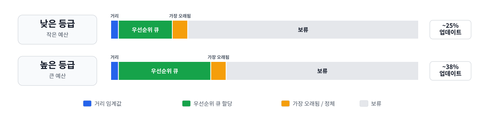
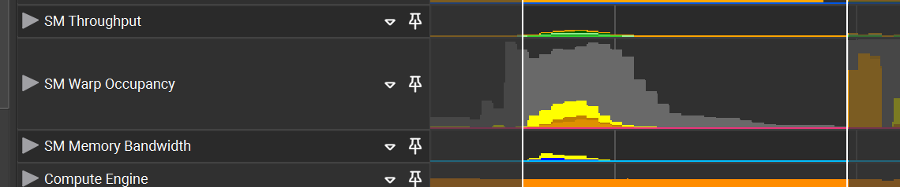
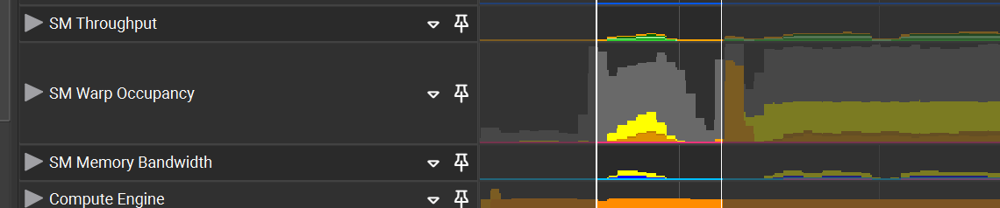

<h1 align="center">게임에서의 실시간 패스 트레이싱</h1>

<em>성능과 확장성을 위한 모범 사례</em>

2026년 6월

## 개요

게임에서의 실시간 패스 트레이싱은 제한된 레이 예산을 최종 재구성
프레임에 가장 크게 기여하는 곳에 사용하는 것이 관건이다. 프로덕션
렌더러는 레이 숫자 예산에 제한이 있고, 깊고 편향되지 않은 레이패스를
사용할 수 없으므로, 직접광, 가시성, 간접광, 굴절, 반사등의 스페큘러
효과, 캐시 업데이트 사이에 레이를 균형 있게 배분해야 한다. 캐시,
디노이저, 업스케일러는 렌더러를 보조하는 주변 시스템이 아니라 렌더러의
일부다.

이 백서는 D3D12/DXR급 하이브리드 렌더러에 초점을 맞추며, NVIDIA RTX
기반기술을 구체적인 사례로 사용한다. 동등한 개념은 Vulkan 레이
트레이싱과 같은 다른 벤더의 구현에도 적용할 수 있지만, 벤더별 기능에는
자체적인 기능 지원 확인과 폴백이 필요하다. 대상 독자는 렌더링 엔지니어와
테크니컬 아티스트다.

## 1. 서론

패스 트레이싱은 픽셀별로 빛이 이동하는 패스를 확률적으로 추적하여 전역
조명(GI)을 근사한다. 오프라인 렌더러는 샘플을 추가하고 수렴할 때까지 더
오래 기다리는 방식으로 품질을 높인다. 게임 렌더러에는 그러한 여유가
없다. 카메라, 애니메이션, 동적 조명, 스트리밍, 후처리가 계속 실행되는
동안 조명 솔루션을 엄격하고 반복 가능한 프레임 예산 안에 맞춰야 한다.

60 FPS에서 전체 프레임 시간은 16.67 ms다. 패스 트레이싱 렌더링에
할당되는 구간은 전체 중 일부에 불과하므로, 렌더러는 적응형 레이
할당,래디언스 캐싱, 기능 등급별 폴백과 같이 확장 가능한 품질 제어를
중심으로 설계해야 한다.

따라서 패스 트레이싱 렌더링은 전체적인 파이프라인으로서 최적화해야 한다.
레이 디스패치 성능은 레이 수와 트래버설 비용뿐 아니라 셰이더 분기 발산,
any-hit 작업, 머티리얼 간접 참조, 메모리 대역폭, 레지스터 압박, 명령어
캐시 동작에도 좌우된다. 전체 프레임 시간에는 가속 구조 업데이트,
디노이징, 업스케일링도 포함해야 하므로, 이 모든 시스템을 함께
프로파일링하고 튜닝해야 한다.

대부분의 출시용 실시간 렌더러에서는 1차 가시성계산을 일반적으로
래스터라이제이션으로 유지해야 한다. 래스터라이제이션이 여전히 G-buffer를
생성하는 가장 효율적인 방법이기 때문이다. 다만 특정 유형의 장면에서는
1차 레이도 여전히 실용적인 선택이 될 수 있다. 패스 트레이싱은 간접광,
복잡한 가시성, 스페큘러 효과, 고품질 그림자, 래디언스 캐시 업데이트처럼
가장 가치가 높은 영역에 적용해야 한다.

### 필수 성능 데이터

이 문서의 지침은 성능이 프리셋별, 플랫폼별로 측정된다는 전제에 기반한다.
엔진은 각 대상 구성에 대해 표 1에 요약된 메트릭을 기록해야 한다.

| 메트릭 | 중요한 이유 |
| :--- | :--- |
| 네이티브 렌더 해상도와 출력 해상도 | 레이 수, 디노이저 비용, 업스케일러 동작은 내부 해상도에 따라 달라진다 |
| 목표 FPS와 프레임 시간 예산 | 30 FPS에서 작동하는 기법이 60 또는 120 FPS에서는 사용 불가능할 수 있다 |
| 신호별 픽셀당 레이 수 | 직접광, 가시성, 간접광, 캐시 업데이트는 각각 레이 하나당 가치가 다르다 |
| 최대 패스 깊이와 종료 조건 | 패스가 깊어지면 비용, 분기 발산, 유지해야 할 상태가 빠르게 증가한다 |
| (TLAS)/(BLAS) 빌드 및 업데이트 시간 | 레이 디스패치가 빠르더라도 동적 장면에서는 업데이트 급증으로 문제가 발생할 수 있다 |
| 레이 디스패치, 디노이징, 업스케일링 시간 | 플레이어가 보는 것은 분리된 개별 패스가 아니라 최종 재구성 프레임이다 |
| 메모리 사용량 | 가속 구조, 래디언스 캐시, 임시 버퍼는 확장성에 영향을 줄 수 있다 |
| 시간적 안정성 메트릭 | 지속적인 고스팅, 히스토리 지연, 디스오클루전 노이즈, 조명 튐 현상은 단일 프레임 오류보다 더 눈에 띄는 경우가 많다 |

*표 1. 필수 성능 데이터*

### 초기 레이 예산 모델

레이 예산은 전역적인 픽셀당 레이 수가 아니라 신호별로 배분한다. 직접광
가시성, 확산 GI, 글로시/정반사 응답, 볼류메트릭, 캐시 업데이트는 각각
노이즈 특성과 인지적 영향이 다르다. 낮은 프리셋은 캐시와 재구성에 크게
의존할 수 있고, 높은 프리셋은 더 많은 광원 후보, 캐시 업데이트, 또는
간헐적인 깊은 패스를 추가할 수 있다.

각 신호에는 고유한 비용 제어 전략이 있어야 한다.

- 직접광: 명시적 광원 샘플링과 가시성 레이를 우선하고, 좋은 샘플을
  인접한 픽셀과 프레임 간에 재사용한다. 작은 광원을 찾기 위해 무작위
  패스 히트에 의존하지 않는다.
- 정반사 및 글로시: 보이는 반사 디테일, 안정적인 히트 거리, 올바른
  정반사 모션을 우선한다. 제한된 VNDF 샘플링을 견고한 기준선으로
  사용한다 [14].
- 확산 GI: 픽셀마다 깊은 패스를 사용하는 대신 얕은 단일 바운스와
  래디언스 캐시 폴백을 함께 사용하는 방식을 우선한다.
- 캐시 업데이트: 공간적으로 더 낮은 빈도에서 더 깊거나 더 높은 품질의
  패스를 실행하고, 여러 프레임에 걸쳐 작업 비용을 분산한다.
- 디노이징 및 업스케일링: 업스케일 전 디노이징 결과물뿐 아니라 지터링과
  업스케일 후 아티팩트를 포함한 최종 재구성 이미지를 검증한다.

## 2. 핵심 개념 복습

패스 트레이싱은 엄격한 실시간 제약 아래 전체 광 전달을 추정하며,
이상적인 물리적 정확성만이 아니라 최종 디노이징 및 업스케일링 이미지의
품질로 평가해야 한다. 비용, 분산, 편향, 시간적 안정성, 재구성 아티팩트
모두가 이 평가에 포함된다.

### 패스 트레이싱과 레이 트레이싱

전통적인 실시간 레이 트레이싱은 흔히 그림자, 반사, 굴절, 앰비언트
오클루전과 같이 제한된 레이 유형을 계산한다. 패스 트레이싱은 완전한 광
패스를 샘플링하여 간접 조명과 표면 간 에너지 교환을 계산한다. 두 방식의
차이는 주로 계산량에 있다. 패스 트레이싱은 더 완전한 광 전달 문제를
풀지만, 샘플당 비용과 비용편차가 더 크다.

### 낮은 샘플 수에서의 몬테카를로 적분

패스 트레이싱은 무작위 또는 저불일치(low discrepancy, 혹은 균일분포)
샘플을 사용해 렌더링 방정식을 추정한다. 픽셀당 레이가 몇 개뿐이면 분산이
지배적이다. 따라서 실시간 수렴은 단순한 샘플 수보다 중요도 샘플링,
재사용, 래디언스 캐싱, 안정적인 시간 누적, 신뢰도 기반 디노이징,
업스케일링에 더 크게 좌우된다.

모든 고에너지 샘플을 무해한 수렴 노이즈로 간주하지 않는다. 드물게
발생하는 물리적으로 타당한 밝은 샘플은 허용할 수 있지만, 래디언스를
극도로 작은 확률 밀도 함수(PDF)로 나누면서 생긴 드문 기여 값은 시간적 및
공간적 디노이저를 오염시킬 수 있다. 수백 또는 수천 개의 샘플을 사용하면
수렴할 값도, 신뢰할 수 있는 히스토리가 몇 프레임뿐인 게임에서는 눈에
띄는 파이어플라이를 만든다.

### 물리적 정확성과 제어된 편향

실시간 구현은 안정성과 성능을 위해 의도적으로 비편향 정확성을 일부
포기한다. 래디언스 캐시, ReSTIR 방식의 재사용, 광원 가지치기, 머티리얼
단순화, 텍스처 MIP 편향, 시간적 디노이징, 업스케일링은 모두 편향을
유발한다. 목표는 편향을 제거하는 것이 아니라, 편향을 안정적이고 예측
가능하며 시각적으로 타당하고 아티스트가 제어할 수 있게 만드는 것이다.

60 FPS에서 안정적인 조명을 생성하는 물리적으로 덜 정확한 솔루션이
깜박임이나 고스팅을 일으키거나 프레임 예산을 충족하지 못하는 더 정확한
솔루션보다 바람직할 수 있다.

### 성능 도구로서의 편향

- 편향을 설계의 일부로 활용할 수 있으며, 파이프라인에서 편향이 유입되는
  지점을 문서화한다.
- 저주파이고 시간적으로 안정적이며 플레이어가 알아차리기 어려운 편향을
  우선한다.
- 카메라 움직임이나 동적 조명에 따라 갑자기 변하는 편향은 피한다.
- 편향을 사용하는 기법은 개별 테스트 사례뿐 아니라 대표 장면에 대해서도
  더 느린 레퍼런스 패스와 비교해 검증한다.
- 낮은 spp 패스에서는 단순한 러시안 룰렛을 피한다. 결정론적 깊이 제한,
  누적 패스 가중치(path throughput) 임계값, 검증된 래디언스 캐시 종료
  방식이 일반적으로 실시간 디노이징에 더 안전하다.

## 3. 실시간 실현 가능성과 기능 등급

실시간 패스 트레이싱은 하드웨어 레이 트래버설, GPU 친화적 장면 데이터,
일관성 있는 셰이더 설계, 명시적 샘플링, 래디언스 재사용, 디노이징이
결합되면서 가능해졌다. 어느 한 가지 기능만으로 실용화되는 것은 아니다.
고급 기능은 기준이 되는 하이브리드 아키텍처 위에 계층화된 선택적 가속
기능이어야 한다.

### 기능 등급

패스 트레이싱 모드를 단순히 켜고 끄는 방식으로만 제공해서는 안 된다.
레이 수, 패스 깊이, 광원 후보, 캐시 업데이트 빈도, 머티리얼 LOD, 가속
구조(AS) 정책, 불투명도 마이크로맵(OMM), 셰이더 실행 재정렬(SER),
디노이징, 업스케일링을 독립적으로 켜고 끌 수 있는 기능 등급을 제공한다.

| 등급 | 핵심 기능 | 사용 사례 |
| :--- | :--- | :--- |
| 기본 하이브리드 | 래스터 G-buffer, DXR TraceRay 또는 RayQuery, 단순한 가시성 레이, 시간적 디노이징 | 최대 호환성 및 첫 통합 마일스톤 |
| 출시용 성능 | RIS/ReSTIR 방식의 직접광 및 간접광, AS 압축/리핏, 머티리얼 LOD, 래디언스 캐시, NRD | 주요 실시간 게임 타깃 |
| 출시용 RTX | SER, OMM, RTXDI, DLSS Ray Reconstruction, HitObject 워크플로, 특화된 RayQuery 패스 | 적절한 폴백을 갖춘 최상의 RTX 품질/성능 패스 |
| 최신 DXR | Clustered Geometry, Partitioned TLAS | 더 세밀한 바운딩 볼륨 계층 구조(BVH)/레이 트레이싱 가속 구조(RTAS) 관리를 위한 추가 API 수준 패스. 별도의 하드웨어 기능은 아님 |

*표 2. 기능 등급과 배포 범위*

### 셰이더 실행 재정렬

셰이더 실행 재정렬(SER)을 사용하면 셰이더 코드에서 분기 발산이 발생한
워크로드를 다시 그룹화하여 실행 및 데이터 코히어런스를 높일 수 있는
지점을 표시할 수 있다. 레이가 복잡한 머티리얼, 분기가 많은 셰이딩 패스,
코히어런스가 낮은 보조 히트 집합과 만날 때 가장 유용하다. SER은 선택적
최적화로 취급한다. 지원 여부를 확인하고 SER 활성화 패스를 분리하며, 대표
콘텐츠에서 적용 전후를 측정한다. SER은 HitObject 방식의 워크플로도
도입한다 [3], [4]. 의미 있는 워크로드 그룹을 구분하는 데 필요한 최소
수의 코히어런스 힌트 비트만 사용한다. 힌트가 없는 기준선과 여러 개의
간결한 힌트 구성을 비교해 테스트하고, 대표 콘텐츠에서 일관된 GPU 시간
개선을 제공하는 비트만 추가로 유지한다.

### 불투명도 마이크로맵과 알파 테스트 콘텐츠

나뭇잎, 울타리, 헤어 카드와 같은 알파 테스트 지오메트리는 많은 수의
any-hit 셰이더 호출을 일으킬 수 있다. 불투명도 마이크로맵(OMM)은
마이크로 트라이앵글의 불투명도를 분류하므로, 불투명 또는 투명한 것으로
알려진 영역에서는 비용이 큰 any-hit 작업을 피할 수 있다. OMM은 전처리,
메모리, 리소스 관리 복잡성을 추가하므로 any-hit 비용이 측정 가능하고
지속적으로 발생하는 곳에 사용한다 [5], [6]. 간접 레이는
`RAY_FLAG_FORCE_OMM_2_STATE`를 사용해 평가하는 방안을 고려한다. any-hit
셰이더를 호출하지 않고 불투명도가 확정되지 않은 마이크로맵 상태를
처리하면 의미 있는 성능 향상을 얻을 수 있기 때문이다. 알파 테스트
디테일의 시각적 기여가 미미할 가능성이 큰 경우에는 특히 성능 중심 품질
모드에서 해당 머티리얼을 불투명으로 강제하는 것도 고려한다 [15].

### 고급 RTAS 기능

Clustered Geometry와 Partitioned TLAS 같은 고급 가속 구조 기능은
렌더러의 기본 요구 사항이 아니라 선택적 확장성 패스로 취급해야 한다. 이
기능의 목적은 규모가 크거나 매우 동적인 장면에서 가속 구조 빌드,
업데이트, 스트리밍 동작을 개선하는 것이다. 이러한 기능에는 명시적인 지원
여부 확인, SDK 및 드라이버 검증, 콘텐츠 파이프라인 지원, 기존 BLAS/TLAS
관리를 사용하는 완전한 기능의 폴백 패스가 필요하다.

## 4. 장면 설계 및 콘텐츠 제작

패스 트레이싱 성능은 렌더러 코드뿐 아니라 장면 구성의 영향도 받는다.
래스터라이제이션에는 문제가 없는 콘텐츠도 레이 트래버설, any-hit 셰이더,
디노이저 안정성 측면에서는 부하가커질 수 있다. 프로덕션 렌더러에는
아티스트가 확인하고 디버깅할 수 있는 콘텐츠 규칙이 필요하다.

### BVH 효율성을 위한 장면 구성

각 BLAS가 지오메트리를 딱 들어맞게 포함하고 빈 공간은 최소화되도록 장면
지오메트리를 구성한다. 정적 지오메트리는 공간적으로 일관된 청크로
그룹화하여, 레이가 느슨하거나 겹치는 경계를 통과하지 않고 장면의 큰
부분을 빠르게 제외할 수 있게 해야 한다. 오브젝트가 서로 가깝고 수명,
업데이트 빈도, 머티리얼 동작, 불투명도 동작, LOD 정책이 같다면
지오메트리를 병합한다. BLAS에 큰 빈 영역, 관련 없는 부분, 불투명
콘텐츠와 알파 테스트 콘텐츠의 혼합, 또는 서로 다른 업데이트 정책이
필요한 오브젝트가 포함될 경우에는 지오메트리를 분할한다. 느슨한 BLAS
경계를 만드는 에셋 레이아웃은 피한다. 매우 길고 가는 삼각형, 크고 얇은
표면, 조밀하게 겹치는 카드는 레이가 필요 이상으로 많은 지오메트리를
탐색하게 만들 수 있다. 프로파일링과 BVH 디버그 뷰를 사용해 이러한 사례를
식별한 다음, 이득이 분명하다면 에셋을 정리하거나 더 작은 공간 청크로
분할한다. 지나친 자동 분할은 추가 청크로 인해 메모리 사용량, 인스턴스
수, 빌드/업데이트 비용이 증가할 수 있으므로 피한다. 하늘과 무한 환경
조명은 거대한 TLAS 지오메트리로 표현하지 말고 미스 셰이더 또는 환경
시스템을 통해 처리한다 [6], [13].

### 레이 종료 유도

레이가 빈 공간을 가로질러 멀리 이동하는 장면은 트래버설 시간을 낭비하고
레이의 분산을 증가시킨다. 실내 벽, 천장, 지형, 대형 오클루더는
자연스럽게 레이 길이를 제한하지만 대규모 오픈 월드에는 명시적인 폴백
정책이 필요하다. 하늘 모델, 환경 프로브, 월드 스페이스 래디언스 캐시,
거리 컷오프, 거리 또는 바운스 임계값을 초과하는 레이를 위한 저비용 캐시
쿼리등 을 고려해볼 수 있다.

### 레이아웃을 통한 간접광 전달 개선

실내 레이아웃은 창문, 출입구, 밝은 개구부, 주요 반사 영역처럼 중요한 광
경로를 더 쉽게 샘플링할 수 있도록 최적화할 수 있다. 레이 가이던스는
포털, 캐시 유도 샘플링, 광원 선택 힌트 또는 이와 유사한 보조 수단을
사용해 레이를 유용한 광 전달 패스로 유도할 수 있다.

인스턴스 마스크로 1차 레이에서 숨긴 발광 지오메트리를 추가하면 창문으로
들어오는 빛, 인접 방조명의 영향, 산란 기반 보조 광원과 같은 복잡한 광
전달을 근사할 수 있다. 이러한 프록시는 노이즈를 줄이고 수렴을 개선할 수
있지만 편향을 유발하므로 장면 설계의 출발점으로 삼아서는 안 된다. 먼저
실제 조명, 샘플링 전략, 래디언스 캐시 배치, 캐시 업데이트 빈도, 캐시
무효화 동작을 튜닝한다. 수렴 또는 조명 응답 시간이 여전히 목표 예산을
충족하지 못할 때만 발광 프록시를 사용한다.

발광 프록시는 조명이 안정된 정적 콘텐츠에 가장 적합하다. 동적 조명 구성,
시간대 변화, 문이 움직이는 경우, 파괴 가능한 장면에서는 프록시가 더 이상
실제 광 전달과 일치하지 않을 수 있으므로 주의해서 사용한다. 프록시는
레퍼런스 패스와 비교해 검증하고, 숨겨진 임시방편이 아니라 아티스트가
제어할 수 있는 조명 보조 수단으로 제공해야 한다.

### 제작 체크리스트

- 불투명, 알파 테스트, 블렌딩 콘텐츠를 분리하되, 불필요한 BLAS 분할은
  피한다.
- 함께업데이트, 컬링, 스트리밍되거나, 동일한 LOD 선택이 이루어지는 로컬
  오브젝트 그룹은 공유 BLAS를 사용한다.
- 거리에 따라 잘 확장되는 프록시와 배칭을 설계하여 TLAS 인스턴스 수를
  예산 내로 유지한다.
- BLAS 업데이트, 그룹화, 프록시를 중심으로 동적 지오메트리를 계획한다.
- 나뭇잎의 바람 애니메이션과 같이 조밀한 애니메이션이 화면에서 명백한
  래스터/트레이스 불일치를 드러낼 수 있다면, RT에서 확장 가능한 패턴으로
  제한한다.

## 5. 가속 구조 및 바운딩 볼륨 계층 구조(BVH) 관리

가속 구조 관리 정책은 성능에 큰 영향을 미치는 결정이므로 면밀하게
계획해야 한다. 목표는 플레이어에게 보이는 조명에서 피할 수 있는 오류를
최소화할 만큼 정확한 장면 표현을 유지하면서, 레이 트래버설 비용,
빌드/업데이트 시의 급격한 부하, 메모리 사용량, 동기화 오버헤드를
최소화하는 것이다.

### 병합/분할 결정 규칙

병합 및 분할 결정은 콘텐츠 제작 체크리스트를 따라야 한다.

### 빌드, 리핏, 리빌드 및 압축

정적 하위 수준 가속 구조(BLAS)에는 빠른 트레이싱 빌드 구성을 사용하고
빌드 후 압축한다. 정적 지오메트리는 빌드 비용을 한 번만 부담하므로,
런타임에서는 높은 레이 트래버설 품질과 메모리 사용량 감소를 목표로 해야
한다.

토폴로지가 안정적이고 변형 범위가 제한된 동적 메시의 경우, BVH 품질을
유지할 수 있다면 리핏 패스를 우선 사용한다. 이러한 BLAS에는 일반적으로
빠른 트레이싱 설정과 압축을 사용해야 한다. 리핏이 항상 최선의 선택이라고
가정해서는 안 되며, 대표적인 메시, 애니메이션 범위 및 장면 조건에서
리빌드와 비교해야 한다.

변형이 크거나, 경계면 변화가 크거나, 리핏 품질이 낮은 일반 동적 메시에는
빠른 빌드/업데이트 설정을 우선한다. 토폴로지가 허용하는 경우 리핏을
사용하되, BVH 품질을 복원하고 시간 경과에 따라 일관된 트레이싱 성능을
유지할 수 있도록 주기적으로 리빌드한다.

AS 빌드, 리핏 및 리빌드를 배치 처리하여 디스패치 비용을 분산하고, GPU
점유율을 높이며, 배리어를 최소화한다. AS 유지 관리와 그래픽 작업을
중첩하는 비동기 실행 경로를 사용하여 GPU 활용률 저하를 숨긴다 [6],
[12].

### 중요도 기반 동적 업데이트

동적 객체의 경우, 활성 동적 객체 집합 전체에 업데이트 예산을 균등하게
분배하는 대신 시각적 영향이 가장 큰 인스턴스의 프레임별 업데이트를
우선한다. 레이 패스 중에 GPU 히트 카운터를 누적하고 비동기식으로 읽어
업데이트 우선순위를 정할 수 있다. 이를 통해 시스템은 근거리 그림자나
반사를 드리우거나 주요 광 패스에 영향을 주는 객체처럼 시각적 정확도에
크게 기여하는 객체의 업데이트에 집중하고, 확산광에만 기여하는 객체의
우선순위는 낮출 수 있다. 이 방식은 가장 중요한 곳에 업데이트를 할당하여
성능과 인지적 품질을 모두 향상한다.

동적 업데이트 예산은 프레임당 인스턴스 한도와 지오메트리 처리 한도로
함께 정의한다. 우선순위 큐는 두 예산에 모두 들어맞는, 영향도가 가장 높은
업데이트를 선택해야 한다. 그래서 다수의 소형 인스턴스나 소수의 대형
메시가 프레임 시간을 눈에 띄게 증가시키지 않는다. 카메라 근처의 객체에는
크기, 가시성 또는 히트 수와 관계없이 거리에 따른 우선순위 가중치를
부여하여 근처 시점에서 동기화 아티팩트가 발생하지 않도록 해야 한다. 그림
1은 스케줄러 예시를 보여준다.

*그림 1. 하위 티어 및 상위 티어 업데이트
예산을 위한 우선순위 큐 할당 예시. 백분율은 예시이며 측정된 목표값이
아니다.*

### 고급 RTAS 기능

동적 객체가 많거나 대규모 영역이 스트리밍되는 장면에서는 고급 레이
트레이싱 가속 구조(RTAS) 기능을 사용하여 가속 구조를 리빌드하거나
부분적으로 업데이트하는 비용을 줄일 수 있다. 적합한 지오메트리를 재사용
가능한 CLAS 템플릿으로 표현할 수 있는 경우 Clustered Geometry가 유용할
수 있으며, 이를 통해 렌더러는 전체 BLAS 리빌드보다 더 적은 비용으로 동적
또는 반복 지오메트리를 리빌드할 수 있다. Partitioned TLAS를 사용하면
대규모 장면에서 변경된 영역이나 인스턴스 그룹만 업데이트할 수 있다.

폴백 요구 사항은 대상 플랫폼 범위에 따라 달라진다. 모든 대상 하드웨어,
API, 드라이버 및 공급업체가 고급 RTAS 패스를 지원하거나 렌더러의 범위가
해당 기능을 지원하는 하드웨어로만 한정된다면 별도의 폴백 패스가 필요하지
않을 수 있다. 그렇지 않다면 기능 지원 여부 확인을 거쳐 해당 기능을
사용하고, 기존 BLAS/TLAS 패스도 유지한다.

### 장단점 요약

**장점**

- 적절한 AS 정책은 레이 트래버설 시간과 프레임 시간 급증을 모두 줄일 수
  있다.
- 히트 기반 업데이트 우선순위 지정은 비용을 가시적 기여도와 직접
  연결한다.

**단점**

- AS 관리는 자체 텔레메트리, 스케줄링 및 QA가 필요한 엔진 하위 시스템이
  된다.
- 지나치게 공격적인 리핏 정책이나 생략된 AS 업데이트는 트레이싱 품질을
  저하하거나 시각적 아티팩트를 유발할 수 있다.

## 6. 지오메트리 데이터

효율적인 지오메트리 데이터 레이아웃은 레이 트레이싱의 메모리 대역폭,
캐시 동작 및 셰이더 비용에 중요하다. 래스터라이제이션과 달리 확산 GI,
글로시 반사 및 그림자 레이와 같은 보조 레이는 지오메트리에 코히어런스가
낮은 방식으로 접근하는 경우가 많으므로, 래스터 1차 가시성에 최적화된
레이아웃은 대역폭을 낭비하고 지연 시간을 늘릴 수 있다.

레이 트레이싱 셰이더는 지오메트리 데이터를 전체 래스터 버텍스 형식이
아니라 최소한의 셰이딩 레코드로 다뤄야 한다. 교차점에는 이미 인스턴스
ID, 프리미티브 ID, 무게중심 좌표, 레이 거리 및 변환 정보가 제공된다.
히트 위치는 레이 데이터로 재구성할 수 있으므로 일반적으로 버텍스
버퍼에서 가져올 필요가 없다. 버텍스 위치는 사용자 지정 지오메트릭
노멀이나 특수 머티리얼 효과처럼 명시적으로 필요한 경우에만 가져와야
한다.

### 데이터 레이아웃 원칙

- 자주 사용하는 속성과 드물게 사용하는 속성을 분리한다. 패킹된 노멀
  데이터, UV, 탄젠트 기저 정보처럼 자주 사용하는 데이터는 캐시 친화적인
  소형 레코드에 보관한다. 보조 UV 세트, 버텍스 컬러 또는 제작용 속성과
  같이 드물게 사용하는 데이터는 별도로 보관한다.
- 속성을 패킹하고 함께 액세스되는 속성끼리 그룹화한다. 속성 레코드는
  일반적인 히트 셰이딩에 필요한 메모리 트랜잭션 수를 최소화해야 한다.
- 타당한 경우 레이 클래스별로 레이아웃을 특화한다. 가시성 레이에는
  불투명도 정보만 필요할 수 있다. 디퓨즈 GI에는 알베도와 노멀이 필요할
  수 있다. 글로시 레이에는 더 완전한 머티리얼 설명이 필요할 수 있다.
  레이 유형별로 서로 다른 히트 셰이더 그룹을 사용하면 도움이 될 수 있다.
- 서로 다른 데이터 레이아웃의 수를 제한한다. 실용적인 범위에서 속성
  세트를 표준화하고, 셰이더 변형을 늘리고 실행 일관성을 떨어뜨리는 UV
  채널, 탄젠트 세트 또는 선택적 버텍스 데이터의 임의 조합은 피한다.
- 스트럭쳐드 버퍼 또는 타입이 있는 버퍼를 우선 사용한다. 바이트 어드레스
  버퍼는 가변 크기 레코드에 여전히 유용하다.
- 종속 메모리 읽기를 최소화한다.
- 특히 any-hit 및 closest-hit 셰이더에서 전역 메모리 읽기에 의존하는
  제어 흐름을 피한다.
- any-hit 셰이더는 극도로 가볍게 유지한다. any-hit 실행은 특히 분기
  발산과 메모리 지연 시간에 민감하다. 알파 테스트 지오메트리에는
  간소화된 알파 값 평가와 결합된 크기가 작은 불투명도 메타데이터를
  사용하고, 사용 가능한 경우 불투명도 마이크로맵(OMM)을 사용해야 한다.

### 레이 트레이싱 특화 예시

인덱스 버퍼는 일반적으로 래스터화와 레이 트레이싱 파이프라인에서
공유되지만, 버텍스 속성 레이아웃은 레이 트레이싱 워크로드에 맞게 특화할
수 있다. 보조 레이(예: 디퓨즈 또는 스페큘러 바운스)는 일반적으로 1차
가시성보다 적은 속성을 필요로 하므로, 이러한 경우 버텍스 데이터를
분리하거나 압축하면 대역폭 부담을 줄일 수 있다. 콤팩트한(크기가 작은)
인코딩은 특히 효과적이다. 예를 들어, 노멀과 탄젠트에는 옥타헤드럴
인코딩이나 기타 SNORM 패킹 형식을 사용할 수 있다. 탄젠트 베이시스 는
흔히 노멀, 패킹된 탄젠트 각도 및 핸디드니스(handedness) 비트로 재구성할
수 있다. 히트 위치는 이미 레이--삼각형 교차 결과로 제공되므로 위치
속성은 명시적으로 가져올 필요가 없는 경우가 많다.

비인덱스 지오메트리는 프리미티브 데이터를 콤팩트(크기가 작은) 연속
메모리 영역에 저장하는 동시에 종속 인덱스 읽기 를 피하고 비일관적 메모리
액세스를 줄일 수 있으므로, 특정 워크로드에 유용한지 평가한다. 이 표현
방식은 텍셀 밀도와 같은 추가 프리미티브별 속성도 인코딩할 수 있어 위치
데이터에 액세스하지 않고도 정확한 MIP 레벨을 평가할 수 있다.

## 7. 머티리얼 및 RT 머티리얼 LOD

물리 기반 렌더링 모델은 일관성을 위해 여전히 중요하지만, 실시간 패스
트레이서는 머티리얼 확장성을 갖춰야 한다. 보조 레이는 일반적으로 1차
래스터 셰이딩보다 일관성이 낮으며, 모든 바운스에서 모든 머티리얼 기능을
충실하게 평가하는 것은 비용 면에서 현실적인 경우가 드물다.

### 큰 머티리얼 단위의 쉐이더 특화로 퍼뮤테이션 폭발 피하기

레이 생성 셰이더의 패스 적분기에서 평가하는 소수의 대분류 BRDF/BSDF
클래스를 우선 사용한다. closest-hit 셰이더는 히트 처리를 특화하고
머티리얼 클래스, 셰이딩 매개변수 및 지오메트리 데이터를 포함하는 소형
표면 레코드를 반환해야 한다. 이를 통해 레이 생성 셰이더는 완전한
머티리얼 우버 셰이더로 변하지 않으면서 바운스 제어, 누적 패스 가중치,
샘플링, 캐시 쿼리 및 종료를 관리할 수 있다 [6].

### 패스 트레이싱용 머티리얼 LOD

| 레이 또는 표면 클래스 | 권장 머티리얼 디테일 |
| :--- | :--- |
| 1차 가시 표면 | 필요에 따라 전체 래스터 머티리얼, 전체 노멀 맵 및 텍스처 스택을 사용한다. |
| 근거리 글로시/정반사 히트 | 안정적이고 세부적인 반사를 유지하도록 고품질 BRDF와 노멀 데이터를 사용한다. 전체 히트 셰이딩의 비용이 높거나 사용할 수 없는 경우 스크린 공간 머티리얼 폴백을 사용한다. |
| 확산 보조 히트 | 축소된 BRDF, 간소화된 노멀, 가능한 경우 캐시 폴백을 사용한다. |
| 캐시 업데이트 히트 | 보수적인 MIP 선택을 사용하는 간소화된 확산형 머티리얼을 평가한다. 래디언스 캐시가 안정적으로 저장하거나 재현할 수 없는 고주파 텍스처, 노멀 또는 BRDF 디테일은 제외한다. |

*표 3. 레이 또는 표면 클래스별 권장 머티리얼 디테일*

### 레이 유형별 머티리얼 LOD 선택

서로 다른 레이 유형은 서로 다른 머티리얼 LOD 히트 그룹을 선택해야 한다.
레이 생성 셰이더가 레이 클래스를 선택하고, 셰이더 테이블이 각 머티리얼
계열에 대해 해당 클래스를 적절한 히트 그룹에 매핑한다. 1차 레이와
준정반사 레이에는 고품질 머티리얼 평가를 사용할 수 있다. 확산 보조
레이와 캐시 업데이트 레이에는 간소화된 BRDF, 보수적인 MIP 및 축소된
텍스처 액세스를 사용할 수 있다. 그림자 및 가시성 레이는 최소한의
불투명도 처리만 사용하고 가능한 경우 closest-hit 셰이딩을 피해야 한다.
이렇게 하면 모든 레이에 전체 머티리얼 평가 비용을 부담시키지 않으면서
히트 패스에서 머티리얼 특화를 유지할 수 있다.

Shader Model 6.9 / SER 지원 패스에서는 `dx::HitObject`를 사용하여 레이
트래버설과 셰이더 호출을 분리할 수 있다. `HitObject::TraceRay()`는
closest-hit 또는 miss 셰이딩을 즉시 실행하지 않고 히트 결과를 반환한다.
그러면 레이 생성 셰이더는 `HitObject::SetShaderTableIndex()`를 사용하여 현재
레이 유형과 머티리얼 LOD에 적합한 셰이더 테이블 레코드를 선택하고,
선택적으로 작업을 재정렬한 후 선택한 셰이더를 호출할 수 있다. 이를 통해
적분기는 어떤 머티리얼 LOD 히트 그룹을 실행할지 직접 제어하면서
closest-hit 셰이더의 머티리얼 특화를 유지할 수 있다.

### 텍스처 샘플링과 레이 콘

레이 트레이싱은 텍스처 LOD에 필요한 스크린 공간 미분값을 자연스럽게
제공하지 않는다. 레이 콘 또는 이와 동등한 근사 방식을 사용하여 레이
풋프린트를 추정한다. 메시별 또는 인스턴스별 스케일 계수를 사용하면 히트
지점의 콘 반경을 MIP 레벨 선택을 위한 대략적인 텍셀 풋프린트로 변환할 수
있다.

### 근사 정책

머티리얼 근사는 레이 유형을 고려해야 하며 최종 디노이징 및 업스케일된
이미지를 기준으로 검증해야 한다. 각 머티리얼을 전체 머티리얼, 간소화된
스페큘러 머티리얼, 간접 디퓨즈 머티리얼, 반투명 그림자 머티리얼과 같은
소수의 RT 친화적 변형으로 컴파일한다.

러프니스가 높은 표면을 향하는 레이, 원거리 레이, 확산 보조 레이 또는
캐시 업데이트 레이에서 고주파 노멀이나 텍스처 디테일이 최종 이미지에
유의미한 영향을 미치지 않는다면 이를 생략한다. 캐시 업데이트 패스는
일반적으로 디퓨즈 머티리얼 패스를 재사용할 수 있지만, 효율 향상을 위해
특화된 레이 생성을 사용해야 한다.

전체 머티리얼 평가의 비용이 지나치게 높다면 보조 레이에 베이크된
머티리얼 프록시를 사용한다.

에너지가 낮은 바운스에는 간소화된 BRDF를 사용하되, 간소화된 머티리얼이
눈에 띄게 더 밝아지거나 선명해지거나 불안정해지지 않도록 알베도, 프레넬,
메탈릭 및 러프니스 동작을 유지한다.

### 장단점 요약

**장점**

- 머티리얼 LOD는 지연 시간, 대역폭 및 셰이더 명령어 부담을 줄인다.
- 거친 머티리얼 클래스는 SBT와 파이프라인 관리를 더 예측 가능하게
  만든다.

**단점**

- 간소화된 보조 셰이딩은 거울과 글로시 표면에서 눈에 띄는 불일치를 만들
  수 있다.
- 머티리얼 클래스가 너무 적으면 하나의 코드 패스 안에서 우버 셰이더
  문제가 다시 발생할 수 있다.

## 8. 효율적인 샘플링 기법

샘플링은 렌더러가 가치 있는 광 패스에 레이를 사용할지, 아니면 분산이 큰
추정에 레이를 낭비할지를 결정한다. 실시간 환경에서는 샘플링을 시간적
재사용 및 재구성과 함께 설계해야 한다. 단일 프레임에서 편향이 없어
보이는 샘플링 방식이라도 디노이저가 추적할 수 없는 불안정한 노이즈를
생성한다면 허용하기 어려울 수 있다.

### 직접 조명

**조명 평가 시 다음 이벤트 추정(NEE)을 사용한다. 즉, 패스가 광원과
우연히 교차하기를 기대하는 대신 불투명 표면의 히트 지점에서 광원을
명시적으로 샘플링한다. 면 광원은 패스 트레이서가 직접 샘플링할 수 있도록
명확하게 정의된 발광 표면으로 표현해야 한다. 이렇게 하면 렌더러가 광원
선택, PDF 평가, 가시성 테스트, 시간적 또는 공간적 재사용에 사용할 수
있는 예측 가능한 데이터를 확보할 수 있다. 폭이 좁은 정반사 로브를 갖는
글로시 머티리얼의 경우, 다중 중요도 샘플링(MIS)을 사용하여 광원 샘플링을
BSDF 또는 VNDF 샘플링과 결합한다.**

NEE-AT와 같은 적응형 NEE 기법은 이전에 관찰된 조명 기여도의 피드백을
사용하여 광원 선택을 개선한다. 균일 샘플링이나 광출력(power) 가중
샘플링에만 의존하는 대신, 인접 픽셀이나 최근 프레임에서 유용했던 광원이
선택될 확률을 높인다. 새로운 광원, 움직이는 광원 또는 이전에 가려져 있던
광원을 발견할 수 있고 로컬 히스토리가 유효하지 않을 때에도 샘플링의
견고성을 유지할 수 있도록 전역 분포도 계속 유지해야 한다 [7].

### 다중 광원 샘플링

광원이 많은 장면에서는 각 셰이딩 지점이 매우 큰 광원 집합에서 하나를
선택해야 할 수 있으므로 단순한 광원 선택 방식은 비효율적이다. 재샘플링
중요도 샘플링(Resampled Importance Sampling)은 소수의 후보 집합을
추출하고 예상 기여도에 따라 후보에 가중치를 부여한 뒤 대표 샘플을
선택하여 확장성을 높인다. ReSTIR는 이 아이디어를 리저버(reservoir)
기반의 시간적·공간적 재샘플링으로 확장하여 유용한 직접광 샘플을 픽셀과
프레임에 걸쳐 재사용할 수 있게 한다 [9].

카메라에 보이는 표면의 직접 조명에는 타일 또는 클러스터 기반 광원 컬링을
사용하여 RIS, 적응형 NEE 또는 ReSTIR DI용 화면 공간 또는 카메라 절두체
광원 목록을 제공할 수 있다. 셰이딩 지점이 화면 타일이나 클러스터화된
절두체 셀에 자연스럽게 매핑되므로 이러한 목록은 1차 셰이딩에 효과적이다.
그러나 리시버가 화면 밖이나 카메라 뒤에 있거나 1차 픽셀의 타일과 무관할
수 있는 2차 또는 간접 패스 히트에는 이를 주된 해결책으로 간주해서는 안
된다.

2차 및 간접 히트에는 월드 공간 광원 샘플링 구조를 사용한다. 카메라 상대
리저버 그리드, ReGIR 방식의 광원 그리드 또는 희소 해시 그리드는 리시버의
화면 위치가 아닌 월드 공간 위치를 기준으로 후보를 제공할 수 있다. 예를
들어 RTXDI의 ReGIR 패스는 표면 또는 볼륨을 위해 월드 공간 광원 그리드를
구성하고 광원 가중치를 적용한다.

희소 월드 공간 해시 그리드는 SHaRC에서 사용하는 것과 동일한 공간 해싱
아이디어를 따르되, 래디언스 캐시 데이터 대신 광원 샘플링 데이터를 저장할
수 있다. SHaRC는 해시 엔트리와 누적/리졸브된 래디언스 버퍼로 구성된 공간
해싱 기반 월드 공간 래디언스 캐시를 사용한다. 다중 광원 샘플링의 경우
유사한 해시 그리드 레이아웃에 후보 광원 ID, 셀별 리저버, 중요도 요약
또는 대략적인 가시성 히스토리를 저장할 수 있다.

활성 상태이거나 최근에 사용된 월드 공간 셀만 해시 테이블에 저장하면
된다. 광원은 영향 범위 또는 예상 기여도와 겹치는 셀에 삽입되며, 셰이딩
지점은 로컬 셀과 필요에 따라 인접 셀을 조회하여 후보를 얻는다. 이렇게
하면 후보 생성이 희소하고 스트리밍에 적합하게 유지되며, 순수한 화면 공간
목록보다 화면 밖 2차 히트에서 더 안정적으로 동작한다.

그리드 또는 리저버 데이터는 최종 조명 평가를 대체하는 것이 아니라 후보
제안 메커니즘으로 사용해야 한다. 선택된 후보는 올바른 PDF 또는 리저버
가중치, 머티리얼 응답 및 전체 장면 가시성을 사용하여 실제 셰이딩
지점에서 여전히 평가해야 한다.

### 주요 광원 및 환경 샘플링

모든 광원 유형을 하나의 범용 샘플러로 처리하려 하지 않는다. 태양, 달 및
강한 방향성 발광체에는 전용 샘플링 패스가 더 효과적인 경우가 많다. 주요
광원과 보조 광원을 분리하면 분산을 줄이고 시간적 안정성을 높일 수 있다.

### 다수의 발광 표면 샘플링

발광 표면이 많은 장면에서는 기본 TLAS와 별도로 발광 광원 샘플링 구조를
유지한다. 이 구조에는 발광 프리미티브 또는 점·스폿·방향·면광원 같은
해석적 프록시와 함께 경계, 광 출력, 면적, 방향성, 머티리얼 ID 및 가중치
등의 샘플링 데이터만 포함해야 한다. 이 구조는 오클루전이 아니라 직접광
후보 생성에 사용된다.\
각 셰이딩 지점에서 이 구조로부터 프리셋에 따라 정해진 소수의 후보를
샘플링한다. RIS 또는 ReSTIR는 올바른 확률이나 리저버 가중치를 사용하여
대표 후보를 유지할 수 있다. 선택된 후보는 여전히 기본 TLAS를 통과하는
가시성 레이로 테스트해야 하며, 최종 조명은 실제 셰이딩 지점, 선택된
발광체 샘플, 머티리얼 응답 및 전체 장면 가시성을 사용해야 한다.\
이 방식은 발광 표면이 많을 때뿐 아니라 발광 메시, 표지판, 애니메이션 VFX
발광체 또는 절차적 발광 머티리얼과 같이 명시적으로 정의된 해석적
광원으로 관리하기 어려운 광원에도 유용하다.

### 디노이저를 고려한 샘플링

- 고주파 플리커보다 안정적인 저주파 노이즈를 우선한다.
- 작은 PDF로 래디언스를 나눈 값이 기여도를 지배하는 비정상 샘플을
  피한다.
- PDF 이상치가 히스토리를 오염시키기 전에 클램핑하거나
  안정화(regularize)한다.
- 낮은 rpp의 게임플레이 패스에서는 단순한 러시안 룰렛을 피한다.
- 캐시 유효성이 높을 때 래디언스 캐시 종료와 함께 결정론적인 깊이/누적
  패스 가중치 제한을 사용한다.
- 특히 ReSTIR 방식의 인접 샘플링에서는 구조적 상관관계를 피할 수 있도록
  공간적/시간적 재사용 패턴을 충분히 무작위화한다.

### 장단점 요약

**장점**

- 명시적 샘플링과 ReSTIR 방식의 재사용은 적은 레이 수에서도 품질을
  향상시킨다.
- 주요 광원, 환경 및 발광체 전용 샘플링 패스는 예측 가능한 분산 제어를
  제공한다.
- 발광체 샘플링 구조를 사용하면 메시 발광체와 해석적 광원으로 관리하기
  어려운 실제 광원을 직접 샘플링할 수 있다.

**단점**

- ReSTIR 방식의 재사용은 무시하기 어려운 오버헤드와 잠재적 편향을
  유발하며 세심한 검증이 필요하다.
- 더 정교한 샘플링은 구현 복잡성과 디버깅 부담을 높인다.

## 9. 광 전달 최적화

다중 바운스 패스 트레이싱은 브루트포스 방식의 비용이 가장 먼저 커지는
영역인 경우가 많지만, 브루트포스 방식이 항상 잘못된 것은 아니다. 제한된
콘텐츠, 제한된 패스 깊이, 하이엔드 프리셋 또는 더 단순한 통합 패스에서는
단순한 브루트포스 솔루션도 유효한 선택이 될 수 있다. 동작을 예측하기
쉽고 레이 수에 따라 확장할 수 있으며 검증도 더 쉽기 때문이다. 그렇더라도
실시간 엔진은 직접 조명, 얕은 패스, 래디언스 캐시 및 통제된 경로
가지치기로 이루어진계층 구조를 사용하여 이러한 기준선 이상으로 확장할 수
있도록 설계해야 한다.

### 래디언스 캐싱

래디언스 캐시는 월드 공간이나 다른 안정적인 도메인에 출사 래디언스의
근사치를 저장한다. 이를 통해 저주파 간접 조명을 픽셀, 프레임 및 패스에
걸쳐 재사용할 수 있다. SHaRC 방식의 캐시와 NRC 방식의 신경망 캐시는 패스
트레이싱과 통합할 수 있으므로, 렌더러가 모든 패스를 깊게 계속 추적하는
대신 히트 지점을 평가하고 캐시된 래디언스를 조회할 수 있다 [10].

### 캐시 업데이트 정책

- 샘플링 및 셰이딩 작업을 구동하는 것과 동일한 신호를 사용하여 캐시
  레코드를 업데이트하며, 카메라 근처, 동적 광원 주변 및 조명 분산이 큰
  영역은 더 자주 업데이트한다.
- 시간적 누적의 신뢰도 메트릭을 사용하여 오래된 히스토리를 감지하고,
  필요할 때 캐시를 초기화하거나 갱신 속도를 높인다.
- 캐시 업데이트 패스는 저주파 간접 조명을 캡처하는 경우가 많다. 이러한
  패스에서는 나뭇잎처럼 알파 테스트 지오메트리가 밀집된 영역을 경우에
  따라 단순화하거나 불투명으로 처리하거나, 먼 거리에서 제외하거나,
  프록시 지오메트리로 표현할 수 있다. 이렇게 하면 레이 트래버설 비용을
  줄일 수 있지만, 나뭇잎이 조명 색상이나 오클루전에 큰 영향을 미치는
  장면에서는 검증해야 한다.

### 환경 맵 및 포털

동적 하늘 조명의 경우 절차적 하늘, 대기, 구름, 달 및 태양 주변 산란을
사용하여 저해상도 환경 맵을 생성한다. 전체 하늘/구름 렌더러는 최종 배경
렌더링을 계속 담당하며, 이 환경 맵은 환경 샘플링, 래디언스 캐시 업데이트
및 간접광 쿼리에 사용한다.

포털 광원은 환경광 기여의 대부분이 창문이나 출입구를 통해 들어오는
실내에서 분산을 줄일 수 있다. 이는 장면별 가이딩 기법이며 광원 샘플링을
보편적으로 대체하는 수단이 아니다. 포털은 실제 개구부와 일치해야 하고
문이나 셔터가 움직일 때 업데이트되어야 하며, 가이딩을 적용하지 않은
베이스라인 패스와 비교하여 검증해야 한다.

### 무시할 수 있는 기여도 프루닝

광원이나 간접 샘플을 건너뛰기 위한 에너지, PDF, 거리 및 누적 패스 가중치
임계값을 명시적으로 설정한다. 임계값을 확장성 제어 항목으로 노출한다.
낮은 프리셋에서는 멀리 있는 발광체, 작은 광원 및 깊고 에너지가 낮은
패스를 적극적으로 가지치기 할 수 있으며, 높은 프리셋에서는 안정성과
정확도를 높이기 위해 임계값을 완화할 수 있다.

### 장단점 요약

**장점**

- 래디언스 캐싱은 게임에서 다중 바운스 조명을 실용화하는 가장 강력한
  도구 중 하나이다.
- 프레임마다 베이크되는 환경 맵을 사용하면 동적 하늘과 구름 조명을
  효율적으로 중요도 샘플링할 수 있다.
- 프루닝과 캐시 업데이트 속도는 명확한 품질/성능 제어 수단을 제공한다.

**단점**

- 캐시는 동적 변화를 제때 따라가지 못해 조명 지연을 유발할 수 있다.
- 포털 및 프록시 시스템은 저작 작업과 튜닝 부담을 늘린다.

## 10. 디노이징 및 레이 재구성

디노이징은 렌더러의 일부이지 최종 마무리 패스가 아니다. 패스 트레이서는
처음부터 안정적이고 종류가 명확히 구분되며 디모듈레이션된 신호와 신뢰할
수 있는 가이드 버퍼를 디노이저와 신경망 재구성에 제공하도록 설계해야
한다.

### 기본 디노이저 통합

검증된 디노이저를 초기에 통합하여 품질/성능 기준선을 확립한다. NRD는
픽셀당 패스 수가 적은 신호를 대상으로 하는 API 독립형 시공간 디노이징
라이브러리이며, 노멀, 러프니스, 히트 거리 및 모션 벡터와 같은 G-buffer
가이드를 사용한다 [8].

### 시간적 누적 정책

장면이 안정적일 때는 시간적 누적에 의존하되, 카메라 컷, 디스오클루전,
조명 변화 및 캐시 무효화 상황에서는 히스토리를 적극적으로 거부하거나 그
비중을 줄인다. 렌더러가 신뢰도 신호를 명시적으로 제공해야 한다.

히스토리 신뢰도는 하드웨어 활용도를 높이기 위해 SHaRC 업데이트와 같은
패스 내에서 계산할 수 있으며, 시간적 신뢰도를 평가하고 누적 동작을
유도하는 간단하고 견고한 메커니즘을 제공한다. NVIDIA NRD는 이를 위한
전용 히스토리 신뢰도 입력을 제공하므로 렌더러가 시간적 유효성을
디노이저에 명시적으로 전달할 수 있다 [8].

### DLSS Ray Reconstruction

DLSS Ray Reconstruction은 지원되는 RTX 구성에서 여러 개의 수작업 튜닝
디노이저를 AI 재구성 패스로 대체하여 샘플링된 레이로부터 더 높은 품질의
픽셀을 생성할 수 있다. 이는 폴백 디노이저를 포함하는 기능 등급으로
통합해야 한다 [11].

SSS, 블러 처리된 유리, 굴절 및 투명 VFX와 같은 공간적 효과를 올바르게
재구성하려면 추가 가이드 버퍼나 전용 합성 순서가 필요할 수 있다. 일부
효과에는 엔진별 가이드 버퍼 재매핑이 필요할 수 있다. 예를 들어 발광
색상을 디퓨즈 또는 스페큘러 알베도에 인코딩해야 할 수 있다.

ReSTIR 방식의 시간적·공간적 재사용은 재구성 전에 시공간적 재사용 패턴의
고정된 상관 관계를 깨야 한다. 이전 프레임의 리저버 선택, 인접 오프셋
또는 재사용 패턴을 무작위화하여 지속적인 상관관계, 서서히 움직이는
그리드 아티팩트 및 반복되는 구조적 오류가 DLSS-RR에 유입되는 것을
방지한다.

### 테스트할 실패 모드

- 카메라 컷 및 빠른 회전.
- 전경 오브젝트 및 얇은 지오메트리 뒤의 디스오클루전.
- 파티클, 데칼, 투명 표면, 블러 처리된 유리, SSS 및 피사계 심도.
- 광원의 켜짐/꺼짐 및 플리커.
- 움직이는 얇은 지오메트리.
- 애니메이션 발광체 및 동적 환경 조명.

## 11. 셰이더 최적화

셰이더 설계는 실시간 패스 트레이싱 효율에 직접적인 영향을 미친다. 패스
트레이싱은 많은 래스터 워크로드보다 분기 발산이 더 크고 유지해야 할
라이브 상태도 더 많다 [16]. 과도한 레지스터 압박은 점유율을 낮추고, 큰
셰이더 본문은 명령어 캐시에 부담을 주며, 과도한 머티리얼 순열은 SBT 및
파이프라인 관리 비용을 증가시킨다.

### 주요 셰이더 목표

- 레이 페이로드를 작게 유지하고 패스 상태를 패킹한다.
- TraceRay 또는 RayQuery 호출에 걸쳐 유지되는 라이브 변수를 최소화한다.
- 가능한 경우 공통 코드를 hit 및 miss 셰이더 외부로 이동한다.
- 머티리얼 코드의 중복을 피하는 동시에 분기 발산이 심한 우버 셰이더도
  피한다.
- 레지스터 수, 점유율, 워프당 활성 스레드 수, 명령어 캐시 동작을
  측정한다.

### 페이로드 접근과 라이브 범위

사용 가능한 경우 페이로드 접근 한정자를 사용해 각 페이로드 필드를 어떤
셰이더가 읽거나 쓰는지 컴파일러에 알려준다. 이를 통해 페이로드의 수명과
접근 의미를 명시적으로 지정하여 레지스터 압박과 스필링을 줄일 수 있다.
임시 변수가 트레이스 호출에 걸쳐 계속 라이브 상태로 남지 않도록 셰이더
코드를 좁은 범위로 구성한다. 라이브 레지스터 사용량을 조사할 때는 Nsight
Graphics Shader Profiler를 사용해야 한다.

### SER과 코히어런스

프로파일링 결과 분기 발산이 심한 레이 워크로드가 재정렬의 이점을 얻는
경우 SER을 사용한다. 여러 머티리얼에 걸친 2차 히트가 좋은 적용 대상이다.
SER은 머티리얼 시스템 수준에서 분기 발산을 줄이는 작업을 대신하지
않으며, 코히어런스를 높이기 위한 추가 도구이다 [3], [4]. Nsight
Graphics GPU Trace의 Active Threads per Warp 뷰는 분기 발산이 심해지는
셰이더 라인을 찾는 데 유용하다.

### 정밀도와 패킹

선택된 머티리얼 계수, 러프니스 중간값, 누적 패스 가중치 성분 또는 압축된
래디언스 데이터와 같이 레지스터에 상주하면서 FP32의 동적 범위가 필요하지
않은 값에는 FP16을 사용한다. 과도한 FP16/FP32 변환 패스는 피한다.
플래그, 레이 유형 및 일부 중간 머티리얼 데이터는 패킹된 정수 비트필드에
저장한다.

정밀도가 허용하는 경우 네이티브 FP16 형식을 사용하되, 스칼라 ALU
처리량이 자동으로 향상된다고 가정해서는 안 된다. 주요 이점은 데이터
풋프린트 감소, 대역폭 절감, 중요 패스의 레지스터 압박 완화이다.

### 명령어 캐시 및 루프 언롤링 검증

생성된 셰이더 코드를 검토하여 컴파일러 휴리스틱이나 명시적 unroll
지시문으로 인해 루프가 불필요하게 언롤링되지 않는지 확인한다. 과도한
언롤링은 셰이더 본문 크기를 크게 늘리고, 명령어 캐시에 부담을 주며,
컴파일 시간을 증가시키고, 라이브 범위를 늘려 점유율을 악화시킬 수 있다.
이는 광원, RIS/ReSTIR 후보, BSDF 로브, 머티리얼 레이어, 텍스처 레이어,
그림자 레이 또는 패스 바운스를 순회하는 루프에서 특히 중요하다.

### 셰이더 검토 체크리스트

| 검사 항목 | 질문 |
| :--- | :--- |
| 페이로드 크기 | 패킹하거나 다시 계산할 수 있는 필드가 있는가? |
| 라이브 상태 | 큰 변수가 트레이스 호출에 걸쳐 계속 라이브 상태로 유지되는가? |
| 순열 수 | 특수화가 분기 발산을 줄이는가, 아니면 코드만 중복하는가? |
| Any-hit 비용 | 콘텐츠를 불투명하게 만들거나, 분리하거나, OMM으로 변환하거나, 단순화할 수 있는가? |
| 머티리얼 간접 참조 | 유효한 셰이딩이 시작되기 전에 종속 메모리 읽기가 몇 번 발생하는가? |
| SER 이점 | 측정된 코히어런스 향상이 해당 패스를 정당화할 만큼 충분한가? |

*표 4. 셰이더 검토 체크리스트*

## 12. TraceRay()와 RayQuery(): 적합한 트레이싱 모델 선택

TraceRay와 RayQuery는 모두 DXR의 일급 메커니즘이다. 어느 쪽도 모든
상황에서 더 빠르지는 않다. 적합한 선택은 SBT 복잡도, 셰이더 구조, 가시성
요구 사항, 그리고 트레이싱을 래스터/컴퓨트 셰이더에 통합할지 레이
트레이싱 파이프라인에 통합할지에 따라 달라진다.

### TraceRay 지침

TraceRay는 전체 hit group 평가, 프로그래밍 가능한 closest-hit/any-hit
로직, 머티리얼 디스패치 및 SBT로 제어되는 셰이더 선택이 워크로드의
핵심인 경우 적합하다. SBT 항목을 간결하게 유지하고, 각 패스마다 가능한
한 적은 수의 상태 객체를 사용하며, 페이로드 크기와 속성 크기를 가능한 한
작게 설정한다 [1], [6].

### RayQuery 지침

RayQuery는 호출자 셰이더 내에서 인라인으로 동작한다. 전체 머티리얼
디스패치가 불필요한 로컬 가시성, 그림자 레이, 캐시 가시성, 조기 종료
검사 및 단순한 트래버설 쿼리에 적합하다. 그러나 인라인 머티리얼 셰이딩이
커지면 분기 발산이 심하고 레지스터 사용 효율이 낮은 우버 셰이더가 될 수
있다 [1], [6].

### 혼합 모델

실용적인 렌더러는 두 메커니즘을 모두 사용할 수 있다. RayQuery는 래스터,
컴퓨트, ray-generation 또는 closest-hit 셰이더에서 가벼운 가시성,
오클루전 및 캐시 검사에 적합하다. TraceRay는 hit group, SBT 제어
디스패치, closest-hit 로직 및 더 풍부한 머티리얼 평가가 필요한 패스
트레이싱 패스에 적합하다.

### 장단점 요약

**장점**

- 두 모델을 모두 사용하면 유연성이 더 높아진다.
- RayQuery는 가벼운 쿼리의 SBT 부담을 줄일 수 있다.

**단점**

- 두 가지 트레이싱 방식을 유지하면 로직이 중복되고 동작이 일관되지 않을
  수 있다.
- 인라인 RayQuery 패스에 머티리얼 코드가 지나치게 많이 누적되면 최적화가
  어려워질 수 있다.

## 13. 디버깅 및 검증

실시간 패스 트레이싱에는 전용 디버깅 및 검증이 필요하다. API 정확성,
트래버설 효율, 셰이더 비용, 디노이저 품질 및 콘텐츠 제작 상태를 모두
확인할 수 있어야 한다. 엔진에는 문제가 나타난 뒤가 아니라 첫 번째 통합
마일스톤부터 검증 모드가 포함되어야 한다.

### 드라이버 및 API 검증

개발 중에는 벤더별 검증 확장 기능과 API 디버그 레이어를 사용한다.
DirectX 12 및 Vulkan용 NVIDIA 레이 트레이싱 검증 기능은 잘못된 SBT 항목,
페이로드 불일치, 잘못된 가속 구조 연산, 잘못된 지오메트리 입력 등 일반
디버그 레이어로 진단하기 어려운 문제를 포착할 수 있다 [12].

### 필수 디버그 뷰

| 디버그 뷰 | 목적 |
| :--- | :--- |
| 신호별 픽셀당 레이 수 | 레이 예산 급증과 신호 불균형을 찾는다 |
| 패스 깊이 및 종료 이유 | 통제되지 않는 패스와 지나치게 공격적인 프루닝을 식별한다 |
| Any-hit 호출 횟수 | 알파 테스트 콘텐츠와 누락된 불투명 플래그를 드러낸다 |
| TLAS/BLAS 빌드 시간 | 동적 장면 업데이트 급증과 스트리밍 문제를 포착한다 |
| 머티리얼 셰이더 비용 히트맵 | 분기 발산이 심하거나 비용이 큰 머티리얼을 찾는다 |
| SER 적용 전/후 시간 | 재정렬이 실제 워크로드를 개선하는지 입증한다 |
| 메모리 구성 내역 | AS, 디노이저, 캐시, 텍스처 및 임시 버퍼의 메모리 부담을 추적한다 |

*표 5. 필수 패스 트레이싱 디버그 뷰*

### 타이머 계측 및 히트맵

픽셀별 타이밍 히트맵은 실제 게임플레이 중 비용이 큰 지오메트리, 머티리얼
핫스폿, 누락된 불투명 플래그 및 트래버설 병목을 드러내므로 레이
트레이싱에 특히 효과적이다. DXR 셰이더 타이머 계측은 프레임에서 TraceRay
비용을 직접 시각화하는 실용적인 방법이다 [13].

### 분리된 카메라 및 고정 LOD 검증

원래 시점에서 렌더링할 때의 LOD를 고정한 상태에서 별도의 장면 카메라를
사용해 BVH 업데이트를 검증한다. 이를 통해 업데이트 정책, LOD 선택 또는
스트리밍 결정이 잘못된 동작을 일으키는 경우를 확인할 수 있다.

### 출시 승인 기준

- 모든 프리셋은 AS 업데이트, 레이 디스패치, 디노이징 및 캐시 작업별로
  분리된 프레임 시간을 기록해야 한다.
- 모든 콘텐츠 벤치마크에는 해당되는 경우 알파 콘텐츠가 많은 장면, 동적
  광원 장면, 글로시 인테리어 및 오픈 월드 장면이 각각 최소 하나씩
  포함되어야 한다.
- 모든 디노이저/재구성 패스는 카메라 컷, 빠른 움직임 및 동적 조명
  조건에서 테스트해야 한다.
- 모든 고급 기능 패스는 성능과 아티팩트 양쪽 모두에 대해 해당 폴백
  패스와 비교해야 한다.

### 장단점 요약

**장점**

- 우수한 계측은 최적화 주기를 단축하고 콘텐츠 문제를 가시적으로
  드러낸다. 드라이버 수준의 검증과 타이머 히트맵은 프레임 캡처만으로
  추론하기 어려운 유형의 버그를 포착한다.

**단점**

- 계측은 코드 복잡도를 높이며 벤더별 패스가 필요할 수 있다.
- 검증 및 히트맵 모드에는 오버헤드가 있으므로 출시 빌드의 성능과
  혼동해서는 안 된다.

## 14. 사례 연구

### SHaRC Update 운용 방식 최적화

RTX 5090에서 1920 × 1080 네이티브 해상도로 실행한 RTXGI2 패스 트레이싱
샘플의 초기 SHaRC Update 프로파일이다. 그림 2는 초기 점유율 프로파일을
보여주며 표 6은 보고된 시간을 요약한다.

*그림 2. 초기 SHaRC Update 점유율 프로파일*

| 구성 | 전체 프레임 | Dispatch Rays | SHaRC Update | SHaRC Query | 베이스라인 대비 개선 | 속도 향상 |
| :--- | :---: | :---: | :---: | :---: | :---: | :---: |
| 베이스라인 참조 | 4.30&nbsp;ms | 3.91&nbsp;ms | — | — | — | 1.00× |
| 베이스라인 + SHaRC | 3.69&nbsp;ms | — | 0.69&nbsp;ms | 2.56&nbsp;ms | 14.2% | 1.17× |
| 베이스라인 참조 + SER | 3.78&nbsp;ms | 3.40&nbsp;ms | — | — | 12.1% | 1.14× |
| 베이스라인 + SHaRC + SER | 3.31&nbsp;ms | — | 0.69&nbsp;ms | 2.16&nbsp;ms | 23.0% | 1.30× |
| **베이스라인 + SHaRC + SER + SHaRC Update에 Force Opaque 적용** | **2.95&nbsp;ms** | **—** | **0.31&nbsp;ms** | **2.19&nbsp;ms** | **31.4%** | **1.46×** |

*표 6. 측정 장면에서의 SHaRC 및 SER 시간 비교*

초기 샘플 구성에서 SER은 SHaRC Query 패스를 개선했지만 SHaRC Update는
개선하지 못했다. SHaRC Query는 2.56 ms에서 2.16 ms로 감소했지만 SHaRC
Update는 0.69 ms에 머물렀다. 프로파일링 결과 Update 패스는 GPU 활용도가
충분하지 않았으며, 지연 시간이 긴 any-hit 셰이더 실행이 비용을 지배했다.
SHaRC Update 레이에 `RAY_FLAG_FORCE_OPAQUE`를 추가하여 해당 any-hit
워크로드를 제거했고, 그 결과 Update 시간이 0.69 ms에서 0.31 ms로
감소했다. 이 장면에서는 이 변경으로 Active Threads per Warp도 개선되고
SM Warp Occupancy가 약 두 배로 증가했다. OMM 지원을 추가하면 알파 테스트
지오메트리의 any-hit 셰이더 실행을 줄여 동일한 병목을 대상으로 삼을 수
있으며, 트레이스되는 모든 지오메트리를 강제로 불투명하게 처리하는 것보다
더 정확한 불투명도 동작을 유지할 수 있다. 예상 효과는 any-hit 호출
감소로 동일하지만, 그 폭은 OMM 적용 범위에 따라 달라진다.

*그림 3. SER 및 `RAY_FLAG_FORCE_OPAQUE` 적용 후 SHaRC Update 점유율*

### 정적 장면 BLAS 평탄화

이 실험은 TLAS 복잡도와 트래버설 오버헤드를 줄여 얻을 수 있는 잠재적인
성능 향상을 보여주기 위해 가능한 한 많은 BLAS를 병합한 의도적으로
극단적인 예시이다. 실제 렌더러에서는 공간적 근접성과 트래버설 비용
분석을 사용하여 품질이 높고 공간적 코히어런스가 우수한 BLAS 클러스터를
생성하는 방식으로 이 최적화를 오프라인에서 수행하는 것이 바람직하다.

**베이스라인:** 14.7 ms (Ray Tracing Traversal 368K 샘플)\
**평탄화:** 11.4 ms (Ray Tracing Traversal 234K 샘플)

평탄화 구성은 프레임 시간을 14.7 ms에서 11.4 ms로 줄여 3.3 ms(22%)
향상을 달성했다. "Ray Tracing Traversal" 샘플 수는 368K에서 234K로
감소하여 134K(36%) 줄었으며, 이는 BLAS 통합을 통해 TLAS 복잡도를 낮출 때
얻을 수 있는 잠재적 이점을 보여준다.

## 15. 결론

게임의 실시간 패스 트레이싱은 성능 예산이 제한된 재구성 시스템으로
설계할 때 실용적이다. 가장 큰 효과를 내는 최적화는 일반적으로 샘플 수를
늘리는 것이 아니라, 레이를 더 효율적으로 할당하고, 불필요한 트래버설을
줄이며, 머티리얼 셰이딩의 코히어런스를 높이고, 가속 구조 업데이트의
확장성을 확보하며, 래디언스 캐싱을 적용하고, 디노이저를 고려해 신호를
생성하며, 견고하게 검증하는 것이다.

출시용 렌더러는 레이 수, 광원 후보, 캐시 업데이트 빈도, 패스 깊이,
머티리얼 단순화, AS 업데이트 정책, OMM/SER 사용, 디노이징 및
업스케일링에 대해 독립적인 품질 제어 기능을 제공해야 한다. 이러한 제어
기능은 하드웨어에 대한 고정된 가정이 아니라 측정된 프레임 시간과 시각적
허용 기준에 연동되어야 한다. 고급 기능은 이식 가능한 베이스라인을
약화시키지 않으면서 하이엔드 패스를 개선해야 한다.

게임을 패스 트레이싱으로 출시하기 전에 이 문서에서 설명한 모든 기법을
가장 진보된 형태로 구현할 필요는 없다. 어떤 프로젝트는 시각적 또는 성능
목표를 달성하기 위해 완성도 높은 최첨단 솔루션이 필요할 수 있지만, 다른
프로젝트는 가장 중요한 문제에 집중한 더 단순한 구현으로도 뛰어나고
실용적인 결과를 얻을 수 있다. 적절한 복잡도 수준은 콘텐츠, 대상
하드웨어, 프레임 시간 예산 및 기대 이미지 품질에 따라 달라진다.

목표는 완벽한 물리적 정확성이나 최고의 기술적 정교함이 아니다. 목표는
플레이어의 프레임 시간 예산에 맞고, 프리셋 전반에서 예측 가능하게
확장되며, 아티팩트가 나타날 때 명확한 진단 정보를 제공하는 안정적이고
응답성이 뛰어난 고품질 조명이다.

## 참고 문헌

**[1]** [Microsoft DirectX Raytracing (DXR) Functional
Spec](https://microsoft.github.io/DirectX-Specs/d3d/Raytracing.html) -
DXR 개념, TraceRay, RayQuery, 페이로드 접근 한정자, OMM 및 레이 트레이싱
등급.

**[2]** [Microsoft DXR Functional Spec, Part
2](https://microsoft.github.io/DirectX-Specs/d3d/Raytracing2.html) -
Clustered Geometry, Partitioned TLAS 및 간접 RTAS 연산 세부 정보.

**[3]** [Microsoft DirectX Developer Blog: D3D12 Shader Execution
Reordering](https://devblogs.microsoft.com/directx/shader-execution-reordering/) -
SER 릴리스 정보, Shader Model 6.9 맥락 및 지원 지침.

**[4]** [Microsoft DirectX Developer Blog: Announcing Shader Model 6.9
Retail and New D3D12
Improvements](https://devblogs.microsoft.com/directx/shader-model-6-9-retail-and-more/) -
Agility SDK 및 Shader Model 6.9 기능 릴리스 관련 정보.

**[5]** [Microsoft DirectX Developer Blog: D3D12 Opacity
Micromaps](https://devblogs.microsoft.com/directx/d3d12-opacity-micromaps) -
OMM 도입 배경, 형식, BLAS 연결 및 기능 확인.

**[6]** [NVIDIA Technical Blog: Best Practices for Using NVIDIA RTX
Ray
Tracing](https://developer.nvidia.com/blog/best-practices-for-using-nvidia-rtx-ray-tracing-updated/) -
AS 구성, 불투명 플래그, 페이로드 크기, 분기 발산, 히트 셰이딩 및
파이프라인 관련 지침.

**[7]** [NVIDIA-RTX RTXPT](https://github.com/NVIDIA-RTX/RTXPT) - NRD,
RTXDI, OMM, SER, DLSS Ray Reconstruction 및 프리셋을 포함한 실시간 패스
트레이싱 샘플.

**[8]** [NVIDIA-RTX NRD](https://github.com/NVIDIA-RTX/NRD) - 실시간
디노이징 라이브러리, 가이드 버퍼, 디노이저 설정 및 통합 참고 사항.

**[9]** [NVIDIA-RTX RTXDI](https://github.com/NVIDIA-RTX/RTXDI) -
ReSTIR 직접 조명, ReSTIR GI 및 ReSTIR PT 구현 프레임워크.

**[10]** [NVIDIA-RTX RTXGI](https://github.com/NVIDIA-RTX/RTXGI) -
패스 트레이싱용 SHaRC 및 NRC 월드 공간 래디언스 캐시 예제.

**[11]** [NVIDIA DLSS Developer
Page](https://developer.nvidia.com/rtx/dlss) - DLSS Super Resolution,
Ray Reconstruction 및 Streamline 통합 개요.

**[12]** [NVIDIA Technical Blog: Ray Tracing Validation for DirectX 12
and
Vulkan](https://developer.nvidia.com/blog/ray-tracing-validation-at-the-driver-level/) -
디버깅하기 어려운 RT 오류와 AS 문제를 위한 드라이버 수준의 레이 트레이싱
검증.

**[13]** [NVIDIA Technical Blog: Profiling DXR Shaders with Timer
Instrumentation](https://developer.nvidia.com/blog/profiling-dxr-shaders-with-timer-instrumentation/) -
픽셀별 타이밍 히트맵 및 셰이더 타이머 계측.

**[14]** [Bounded VNDF Sampling for Smith--GGX
Reflections](https://gpuopen.com/download/publications/Bounded_VNDF_Sampling_for_Smith-GGX_Reflections.pdf)

**[15]** [Path Tracing Optimizations in Indiana Jones™: Opacity
MicroMaps and Compaction of Dynamic
BLASs](https://developer.nvidia.com/blog/path-tracing-optimizations-in-indiana-jones-opacity-micromaps-and-compaction-of-dynamic-blass/) -
RT 셰이더에서의 알파 테스트.

**[16]** [Path Tracing Optimization in Indiana Jones™: Shader
Execution Reordering and Live State
Reductions](https://developer.nvidia.com/blog/path-tracing-optimization-in-indiana-jones-shader-execution-reordering-and-live-state-reductions)
